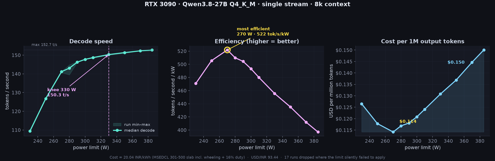
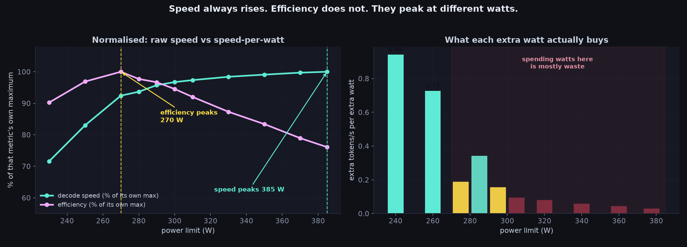
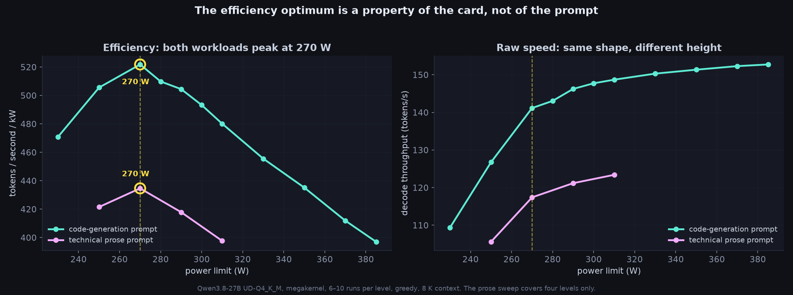
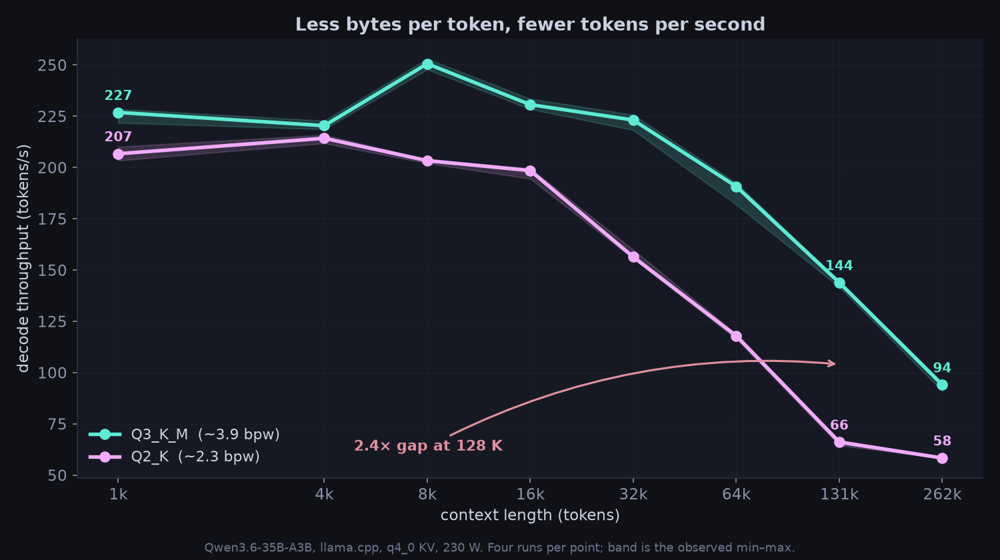
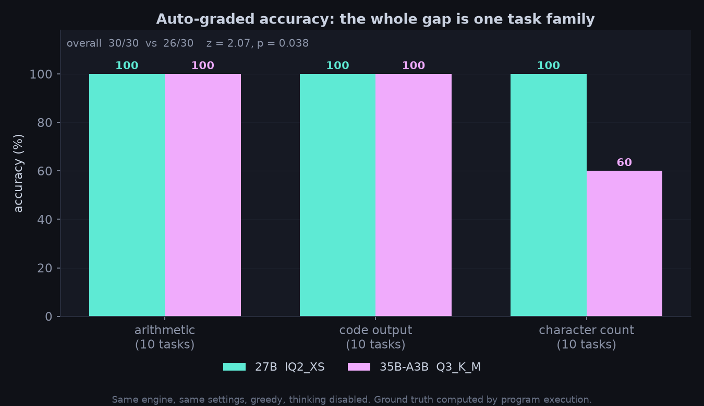
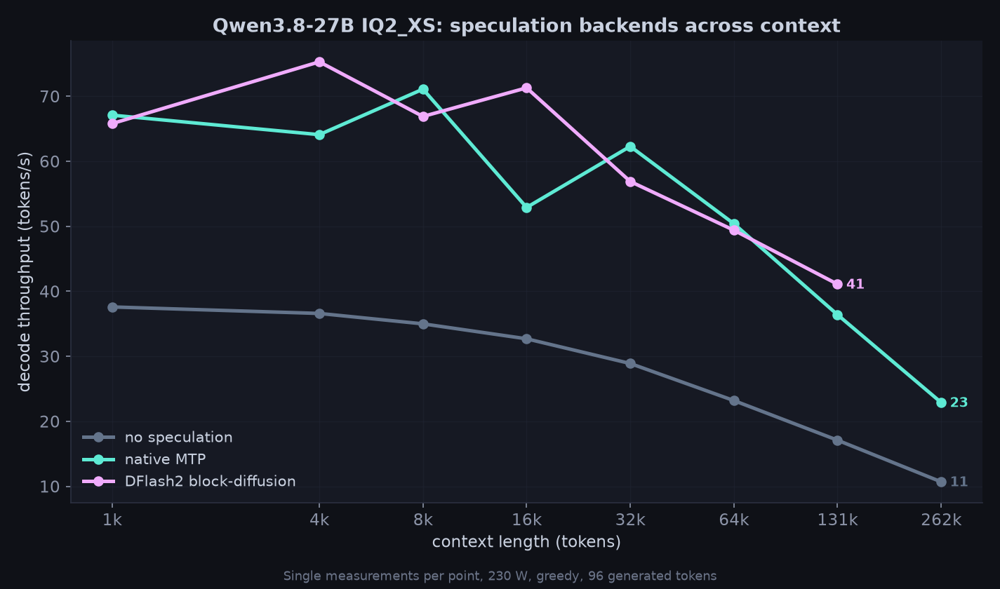

# Local LLM inference on one RTX 3090

**A measured study of speed, context length, and watts — on hardware anyone can buy.**

[**Read the full study →**](STUDY.md) · [Method notes](#what-we-got-wrong) · [Reproduce](#reproduce)



> One consumer graphics card, one user, batch size 1. **250.6 tokens/s** at 8 K context.
> **94.0 tokens/s** with the full 262,144-token window resident. **$0.11–0.17 per million output
> tokens** in electricity. And the fastest setting is not the cheapest one.

---

## Headline numbers

| | |
|---|---|
| Fastest configuration measured | **250.6 tok/s** — Qwen3.6-35B-A3B (Q3_K_M) + MTP, `llama.cpp`, 8 K, 230 W |
| Fastest at full native context | **94.0 tok/s** at 262,144 tokens, 21.2 GB VRAM |
| Fastest single-stream 27B | **152.8 tok/s** — Q4_K_M on a single-kernel CUDA engine, 385 W |
| Most efficient operating point | **270 W** — 521.8 tok/s per kW, minimum joules per token |
| Engine gain, same model | **~1.5×** over `llama.cpp` at equal power, at ~2× the weight precision *(indicative)* |
| Full native context on 24 GB | **262,144 tokens** at 23,855 MiB, 5-bit KV + 8-bit recency window |
| Prefix caching, 256 K | a follow-up turn costs **0.22 s** instead of **198 s** (**904×**) |
| 2-bit vs 4-bit weights | 2-bit is **slower at every depth** — 58 vs 94 tok/s at 262 K |
| Accuracy probe | 27B **60/60**, 35B-A3B **53/60** (z = 2.73, p = 0.006) |
| What actually dominates a 24/7 bill | **idle draw + lit monitors** — 60–70 % |

---

## Finding 1 — the fastest point is not the cheapest one

Speed rises monotonically with the power limit. **Efficiency does not.** It peaks at 270 W and then
falls, because GPU power scales super-linearly with clock: the last 115 W buy 8 % more speed for
42 % more power.



That peak is not an artefact of one prompt. Repeating the sweep on a second, independent workload
puts the efficiency maximum at **270 W again** — the level of the curve moves, the position of the
maximum does not.



---

## Finding 2 — fewer bits per token, fewer tokens per second

The study started intending to run everything at 2 bits. The measurement refused:

| Context | Q2_K (~2.3 bpw) | Q3_K_M (~3.9 bpw) | Deficit |
|---|---|---|---|
| 1 K | 206.7 | **226.8** | −8.9 % |
| 32 K | 156.4 | **223.2** | −29.9 % |
| 128 K | 66.1 | **143.9** | −54.1 % |
| 262 K | 58.3 | **94.0** | −38.0 % |

A smaller file, **2.2× slower at 128 K** on identical hardware and settings. Prefill is unchanged, so
the penalty is specific to speculative decode — most plausibly because the draft head is quantised
along with everything else.



---

## Finding 3 — 262,144 tokens fits in 24 GB, and context costs speed not accuracy

Full native context fits only because the KV cache is stored at **5 bits with an 8-bit recency
window**. At 8 bits the cache alone would be ~9.8 GB and the working set would not fit; at 16 bits it
is not close.

| Preset | K/V bits | Max context | Peak VRAM |
|---|---|---|---|
| default | 8 / 8 | ~120 K | 22,383 MiB |
| **F** | 5 / 5, K rotated | **262,144** | **23,855 MiB** |

Filling the context does **not** erode accuracy. Thirty auto-graded tasks with 64 K of irrelevant
padding in front scored **27/30** against **26/30** with 1 K of padding — one task improved, none
regressed. The cost of long context is throughput, not correctness.



---

## Finding 4 — the two trained drafters are interchangeable; the stock one is the practical one

Native MTP and block-diffusion DFlash2 trade places by context and neither dominates. MTP is the one
that runs in stock `llama.cpp` with a single flag.



---

## What we got wrong

Documented in the study rather than quietly fixed, because these are what make published numbers
irreproducible:

- **`nvidia-smi -pl` fails silently.** In 17 of 108 attempts the card kept behaving as if capped
  lower — exit code 0, driver reporting the requested value. Every power number here is validated
  against actual draw.
- **Speculative throughput depends on what the model writes.** Draft acceptance ranged 54–73 % at
  identical context, giving up to 13 % spread. Single-run benchmarks measure luck.
- **Our own claims.** The 27B was assumed dense in attention (it is hybrid: 48 of 64 layers keep no
  KV); the naive KV estimate was 4.8× too high; the "19×" figure we first published was wrong; an
  entire 290 W level was invalid; and a claimed server/CLI speed-up was withdrawn because the prompts
  differed.
- **Check the tensor table, not the filename.** Two popular GGUF distributions silently dropped the
  MTP block that makes them fast.

---

## Repository layout

```
STUDY.md                  the paper — 1,631 lines, 43 tables, 6 figures, 17 references
README.md                 this page
AGENTS.md                 guidance for AI agents working in this repo

data/                     every measurement, as CSV
  results_llama_rep3.csv    replicated 35B context series (4 runs/depth)
  results_power.csv         115 power-sweep rows across 2 workloads, with validity flags
  results_energy.csv        integrated decode-window energy, 3 runs/level
  results_accuracy.csv      180 graded answers, 6 model/seed configurations
  results_longctx.csv       does 64 K of padding hurt accuracy?
  results_27b_spec.csv      27B speculation ladder, 1 K → 262 K
  results_mk*.csv           megakernel context data

scripts/                  measurement harness (produces data/)
  measure.py                engine-agnostic context sweep, tokenizer-calibrated
  power_cli_sweep.py        power sweep that rejects runs where -pl didn't apply
  energy_sweep.py           10 Hz power sampling over the decode interval
  accuracy_eval.py          auto-graded probe, ground truth by program execution
  longctx_eval.py           accuracy under context padding
  run_*.sh                  server launchers

analysis/                 verification and figures (consumes data/)
  assert_paper.py           30 assertions — every headline number checked against the CSVs
  verify_paper.py           recomputes every table
  check_tables.py           markdown table consistency
  plot_*.py                 the six figures

figures/                  published PNGs
docs/                     running notes, decisions, earlier summary
```

---

## Reproduce

```bash
python3 -m venv .venv && .venv/bin/pip install matplotlib

.venv/bin/python analysis/assert_paper.py      # 30 checks; exits non-zero on mismatch
.venv/bin/python analysis/verify_paper.py      # regenerate every table from the CSVs
.venv/bin/python analysis/check_tables.py STUDY.md
```

Measurement commands for both engines are in
[Appendix E of the study](STUDY.md#appendix-e--configuration-manifest).

---

## Hardware and software

| | |
|---|---|
| GPU | RTX 3090, 24 GB GDDR6X, SM 8.6, 82 SMs |
| CPU | Intel i9-14900K, PL1 95 W / PL2 125 W |
| RAM | 125 GiB |
| OS | CachyOS, Linux 7.2.9 |
| CUDA | 13.4.92 |
| Engines | `llama.cpp` b43bd7a · `qwen38-megakernel` ed0d237 |
| Prices | MSEDCL LT-I(B) FY 2026-27 · USD/INR 93.44 |

All numbers are single-stream, batch size 1, greedy decoding, measured 18 November 2026.

---

## Citation

If you use any of this, link the repo rather than quoting a number out of context — several of them
depend on the prompt family and the power limit.

```
Boi. Speed, Context, and Watts: A Measured Study of Single-Stream LLM Inference on One RTX 3090.
2026. https://github.com/boinoboi/local-llm-3090-bench
```
