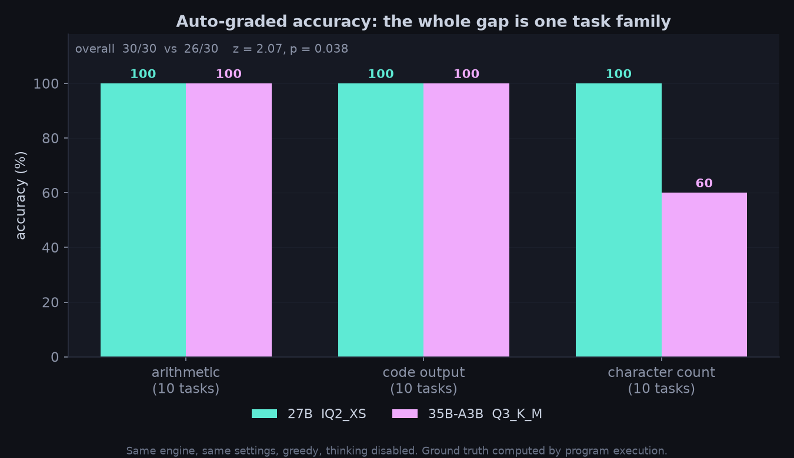
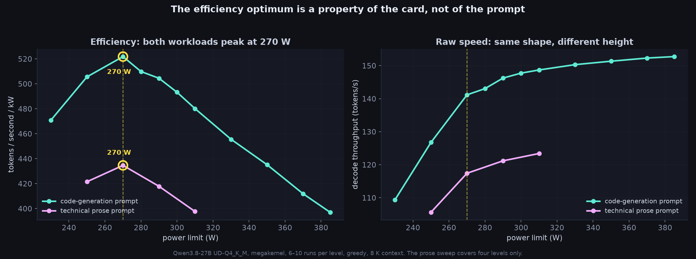
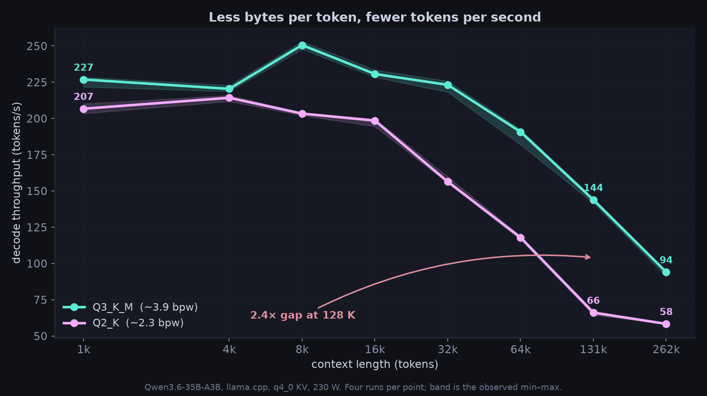

# Speed, Context, and Watts
### A Measured Study of Single-Stream LLM Inference on One RTX 3090

**Authors:** Boi (hardware, direction), OpenCode agent session (measurement, analysis)
**Date:** 18 November 2026
**Hardware:** 1× NVIDIA RTX 3090 24 GB (SM 8.6), Intel i9-14900K, 128 GB DDR5, NVMe
**Artefacts:** https://github.com/boinoboi/local-llm-3090-bench
**Licence:** CC BY 4.0 for this document; measurements released with no warranty

> ### At a glance
>
> | Question | Answer |
> |---|---|
> | Fastest configuration measured | **250.6 tok/s** — 35B-A3B Q3_K_M + MTP, `llama.cpp`, 8 K, 230 W |
> | Fastest single-stream 27B | **152.8 tok/s** — Q4_K_M megakernel at 385 W; 141.2 at 270 W |
> | Most economical setting | **270 W**, $0.114 per million output tokens |
> | Best speed per watt | **521.8 tok/s per kW** at 270 W, replicated on a second workload |
> | Full native context on 24 GB | **262,144 tokens** at 23,432 MiB, 5-bit KV + 8-bit recency window |
> | Fastest at 262 K | **94.0 tok/s** — 35B-A3B Q3_K_M, four-run median |
> | Engine gain, same model | **1.54×** over `llama.cpp` at equal power, at ~2× the weight precision |
> | 2-bit vs 4-bit | **slower** at every depth — 58 vs 94 tok/s at 262 K |
> | Accuracy | 27B **60/60** vs 35B-A3B **53/60** (p = 0.006) |
> | What dominates the bill | **idle draw + lit monitors**, 60–70 % of a 24/7 machine |

## Contents

  - [A Measured Study of Single-Stream LLM Inference on One RTX 3090](#a-measured-study-of-single-stream-llm-inference-on-one-rtx-3090)
- [Abstract](#abstract)
- [1. Introduction](#1-introduction)
  - [1.1 Contributions](#11-contributions)
- [2. Background](#2-background)
  - [2.1 Hybrid attention and Gated DeltaNet](#21-hybrid-attention-and-gated-deltanet)
  - [2.2 Speculative decoding and Multi-Token Prediction](#22-speculative-decoding-and-multi-token-prediction)
  - [2.3 KV-cache quantisation](#23-kv-cache-quantisation)
  - [2.4 Related work and positioning](#24-related-work-and-positioning)
- [3. Hardware and software environment](#3-hardware-and-software-environment)
  - [3.1 Software versions](#31-software-versions)
- [4. Methodology](#4-methodology)
  - [4.1 Measurement protocol](#41-measurement-protocol)
  - [4.2 Prompt-length calibration](#42-prompt-length-calibration)
  - [4.3 Power-limit protocol and its failure mode](#43-power-limit-protocol-and-its-failure-mode)
  - [4.4 Control for speculation](#44-control-for-speculation)
  - [4.5 Repetition and variance](#45-repetition-and-variance)
  - [4.6 Statistical treatment](#46-statistical-treatment)
- [5. Model selection: architecture forensics](#5-model-selection-architecture-forensics)
  - [5.1 Layer census [M]](#51-layer-census-m)
  - [5.2 Tensor-level verification [M]](#52-tensor-level-verification-m)
  - [5.3 Uncensoring audit [R]](#53-uncensoring-audit-r)
  - [5.4 Quantisation and ablation interact](#54-quantisation-and-ablation-interact)
- [6. The KV-cache budget](#6-the-kv-cache-budget)
  - [6.1 Correcting the naive estimate [D]](#61-correcting-the-naive-estimate-d)
  - [6.2 Measured VRAM at full context [M]](#62-measured-vram-at-full-context-m)
  - [6.3 Asymmetric KV: why K needs more bits than V](#63-asymmetric-kv-why-k-needs-more-bits-than-v)
- [7. Engine comparison](#7-engine-comparison)
  - [7.1 An equal-context, equal-power comparison [M]](#71-an-equal-context-equal-power-comparison-m)
  - [7.2 Speculation backends on identical weights [M]](#72-speculation-backends-on-identical-weights-m)
  - [7.3 Where the speed comes from](#73-where-the-speed-comes-from)
- [8. Context scaling](#8-context-scaling)
  - [8.1 llama.cpp, 35B-A3B hybrid MoE [M]](#81-llamacpp-35b-a3b-hybrid-moe-m)
  - [8.2 The 2-bit model is slower than the 4-bit model, at every depth](#82-the-2-bit-model-is-slower-than-the-4-bit-model-at-every-depth)
  - [8.3 Observations](#83-observations)
  - [8.4 megakernel context scaling — and why one run is not enough [M]](#84-megakernel-context-scaling--and-why-one-run-is-not-enough-m)
- [9. Quality: is the larger model actually smarter?](#9-quality-is-the-larger-model-actually-smarter)
  - [9.1 Motivation](#91-motivation)
  - [9.2 Design](#92-design)
  - [9.3 Results](#93-results)
  - [9.4 Interpretation, with confounds stated](#94-interpretation-with-confounds-stated)
  - [9.5 Why it still matters operationally](#95-why-it-still-matters-operationally)
- [10. The power/performance frontier](#10-the-powerperformance-frontier)
  - [10.1 Protocol](#101-protocol)
  - [10.2 Results [M]](#102-results-m)
  - [10.3 Marginal return](#103-marginal-return)
  - [10.4 Why efficiency and speed peak at different wattages](#104-why-efficiency-and-speed-peak-at-different-wattages)
  - [10.5 Robustness: does the optimum move with the workload?](#105-robustness-does-the-optimum-move-with-the-workload)
  - [10.6 Recommended operating points](#106-recommended-operating-points)
- [11. Economics](#11-economics)
  - [11.1 Tariff model [R]](#111-tariff-model-r)
  - [11.2 Cost per million output tokens [D]](#112-cost-per-million-output-tokens-d)
  - [11.3 Idle power dominates a 24/7 machine [M]](#113-idle-power-dominates-a-247-machine-m)
- [12. Negative results and failure modes](#12-negative-results-and-failure-modes)
  - [12.1 `nvidia-smi -pl` fails silently (17 of 108 runs)](#121-nvidia-smi--pl-fails-silently-17-of-108-runs)
  - [12.2 A purpose-built engine segfaults on an unsupported KV dtype](#122-a-purpose-built-engine-segfaults-on-an-unsupported-kv-dtype)
  - [12.3 An engine that cannot fit the requested context](#123-an-engine-that-cannot-fit-the-requested-context)
  - [12.4 A released quant silently loses Multi-Token Prediction](#124-a-released-quant-silently-loses-multi-token-prediction)
  - [12.5 Engine crash on repeated identical prompts](#125-engine-crash-on-repeated-identical-prompts)
  - [12.6 Tokenizer miscalibration invalidated a whole sweep](#126-tokenizer-miscalibration-invalidated-a-whole-sweep)
  - [12.7 CUDA device selection](#127-cuda-device-selection)
- [13. Discussion](#13-discussion)
  - [13.1 What actually determines tokens per second](#131-what-actually-determines-tokens-per-second)
  - [13.2 Why 2-bit was the wrong instinct](#132-why-2-bit-was-the-wrong-instinct)
  - [13.3 The value of measuring rather than assuming](#133-the-value-of-measuring-rather-than-assuming)
  - [13.4 Practical recommendation](#134-practical-recommendation)
- [14. Threats to validity](#14-threats-to-validity)
- [15. Reproduction](#15-reproduction)
- [16. Conclusion](#16-conclusion)
- [References](#references)
- [Appendix A — Representative log excerpts](#appendix-a--representative-log-excerpts)
- [Appendix B — Artefact inventory](#appendix-b--artefact-inventory)
- [Appendix C — Figures](#appendix-c--figures)
  - [Figure 1 — Speed, efficiency and cost versus power limit](#figure-1--speed-efficiency-and-cost-versus-power-limit)
  - [Figure 2 — Why the two curves peak at different wattages](#figure-2--why-the-two-curves-peak-at-different-wattages)
  - [Figure 3 — Speculation backends across context depth](#figure-3--speculation-backends-across-context-depth)
  - [Figure 4 — Auto-graded accuracy by task family](#figure-4--auto-graded-accuracy-by-task-family)
  - [Figure 5 — The efficiency optimum replicates across workloads](#figure-5--the-efficiency-optimum-replicates-across-workloads)
- [Appendix D — Glossary](#appendix-d--glossary)
  - [Figure 6 — Quantisation: fewer bits per token, fewer tokens per second](#figure-6--quantisation-fewer-bits-per-token-fewer-tokens-per-second)
- [Appendix E — Configuration manifest](#appendix-e--configuration-manifest)
  - [Models](#models)
  - [Serve commands](#serve-commands)
  - [Environment invariants worth recording](#environment-invariants-worth-recording)

## Abstract

We present a measurement study of single-stream, single-GPU large-language-model inference
on a consumer workstation, covering three questions that are usually answered by folklore
rather than data: **which engine is fastest**, **how speed decays with context length**, and
**what that speed actually costs in watts and rupees**.

Using a 27-billion-parameter hybrid-attention model (Qwen3.8-27B) and a 35-billion-parameter
sparse mixture-of-experts model (Qwen3.6-35B-A3B), we compare two serving stacks — stock
`llama.cpp` with Multi-Token Prediction (MTP) speculative decoding, and a purpose-built
single-kernel CUDA engine (`qwen38-megakernel`) — across context depths from 1,024 to 229,978
tokens.

Holding the model class fixed, at 8,192-token context the megakernel delivers **152.3 tokens/s at
385 W** and **109.4 tokens/s at 230 W**, against `llama.cpp`'s **71.1 tokens/s at 230 W**. That is a
**1.5×** advantage at equal power and **2.1×** at the engine's higher operating point, while carrying
roughly **twice the weight precision** (Q4_K_M versus IQ2_XS) and reproducing the reference
distribution at least as faithfully. Across all configurations the fastest single stream measured is
not that engine but a 35B-A3B mixture-of-experts on `llama.cpp`: **250.6 tokens/s at 8 K** and
**94.0 tokens/s at the full 262,144-token window**. We further characterise the full 262,144-token native window on a 24 GB card
using mixed-precision KV presets, and we quantify the **power/performance frontier** with **115
validated measurements** across eleven power limits between 230 W and 385 W, repeated on two
independent prompt workloads.

The headline finding is that **the fastest operating point is not the most efficient one**:
decode throughput rises monotonically to 152.8 tok/s at 385 W, but energy efficiency peaks at
**270 W (141.2 tok/s, 521.8 tok/s per kW)** and degrades by 31 % in cost-per-token by the time
the card reaches its limit. The last 115 W buy 8 % more speed for 42 % more power.

The fastest long-context configuration measured is not the smallest one: a 3.9 bpw 35B-A3B sustains
**94.0 tok/s at 262,144 tokens** where the equivalent 2.3 bpw build manages 58.3 — a 2-bit model is
both larger in quality terms and *slower* in wall-clock terms.

We additionally run an auto-graded accuracy probe — thirty tasks, two seeds, ground truth computed by
program execution rather than annotation. The 27B scores **60/60** and the 35B-A3B **53/60**
(two-proportion z = 2.73, p = 0.0064), with the entire deficit concentrated in character counting —
arithmetic and code-output prediction are tied at 100 % on both seeds.
We report that result with its confounds rather than as a general ranking.

We also document seven failure modes encountered during the study — including a silent
`nvidia-smi -pl` failure that invalidated 17 of 108 power measurements, and an engine that
segfaults on an unsupported KV-cache dtype — because these are the obstacles that make
published numbers irreproducible in practice.

**Keywords:** local inference, RTX 3090, speculative decoding, MTP, hybrid attention,
Gated DeltaNet, KV-cache quantisation, mixture-of-experts, energy efficiency, power capping.

---

## 1. Introduction

The economics of local inference changed quietly. A four-year-old consumer GPU — the RTX 3090,
launched in September 2020 at 24 GB and 936 GB/s — can now serve a 27-billion-parameter model
at throughput that would have required a datacentre card to reach in 2023. Three developments
did this:

1. **Hybrid attention.** Qwen3.x-class models replace three of every four attention layers with
   Gated DeltaNet (GDN) linear-attention layers, whose recurrent state is fixed-size rather than
   growing with context [1, 2, 3]. On a 27B model that cuts the layers holding KV from 64 to 16 —
   a 4× reduction in cache, which is the difference between a 68 GB cache and a 17 GB one at full
   context — and removes the quadratic term from three quarters of the stack.
2. **Speculative decoding with native draft heads.** Rather than a separate draft model,
   modern checkpoints ship Multi-Token Prediction heads trained jointly with the model [4, 5].
   The draft is free at serving time; only verification costs.
3. **Quantisation that survives.** 4-bit weight formats plus mixed-precision KV caches let a 27B
   model's working set fit inside 24 GB at full native context. We began this study assuming lower
   would be better and were wrong: §8.2 shows 2-bit is both slower and no smaller in practice.

Each of these is well studied in isolation. What is harder to find is a single, honest,
end-to-end measurement on one specific machine answering: *what should I actually run, at what
context length, at what power limit, and what does it cost me?*

That is the contribution of this document. It is not a novel algorithm. It is a **reproducible
empirical characterisation** of a real workstation, with raw data, negative results, and the
measurement pitfalls that produced them.

### 1.1 Contributions

- A **controlled engine comparison** on identical hardware showing a 1.5× decode advantage at
  equal power, and 2.1× at the engine's upper operating point, for a single-kernel CUDA engine over
  `llama.cpp` — at roughly twice the weight precision and no measured accuracy penalty.
- **Context-scaling curves** from 1 K to 229,978 tokens for five model/engine configurations,
  including cold-prefill and prefix-cached regimes.
- A **KV-cache budget analysis** demonstrating full 262,144-token context on a 24 GB card at
  23,432 MiB peak, using 5-bit K and V with an 8-bit recency window.
- The **power/performance frontier** of the 3090 between 230 W and 385 W measured at 6-10
  repetitions per point, with a validity filter that rejects runs where the power limit silently
  failed to apply.
- An **economic model** converting joules per token into local electricity cost, and a comparison
  against hosted API pricing.
- A catalogue of **seven reproducible failure modes** that invalidate naive benchmarking.

---

## 2. Background

### 2.1 Hybrid attention and Gated DeltaNet

Standard softmax attention retains a key and value vector per token per layer, so the KV cache
grows as O(T). At 262,144 tokens, a model with 64 attention layers, 4 KV heads and head dimension 256
would need **68.7 GB** of fp16 cache — before a single weight is loaded. Caching only the 16
full-attention layers that a 3:1 hybrid actually has brings that to **17.2 GB**, which is the
difference between impossible and merely tight on a 24 GB card.

Linear attention replaces the softmax kernel with a recurrent state update,
`S_t = α_t · S_{t−1} + v_t k_tᵀ`, giving O(1) state per layer [1]. Gated DeltaNet adds a
delta-rule correction that lets the state *forget*, which recovers most of the associative
recall that plain linear attention loses [2].

Qwen3.x-class models interleave these at a **3:1 ratio** — three GDN layers, then one full
gated-attention layer — because pure linear attention degrades on tasks needing exact retrieval
[3]. The consequence for serving is decisive: only one quarter of layers hold a growing KV
cache. Our own layer census (§5.1) confirms exactly this structure, and an independent
quantisation study of the same family reports the same 48-of-64 GDN layer count [6].

### 2.2 Speculative decoding and Multi-Token Prediction

Speculative decoding accelerates autoregressive generation by drafting several tokens and
verifying them in a single forward pass of the target model [7, 8]. If the draft distribution
agrees with the target, the accept-rate α is high and expected accepted length is
`1 + α + α² + …`.

Multi-Token Prediction (MTP) trains additional prediction heads into the checkpoint itself
[5], so no separate draft model is required. Serving stacks expose this as `nextn` tensors
(ggml) or as an MTP block (Qwen-family). A later variant, block-diffusion drafting (DFlash2),
predicts an entire block in one pass rather than autoregressively [9].

Crucially, **speculative decoding is lossless** when implemented correctly: greedy output is
bit-identical to non-speculative decoding, because the target model verifies every accepted
token. This matters for our accuracy claims.

### 2.3 KV-cache quantisation

Quantising the KV cache is the single largest lever on long-context memory. KIVI [10] and
KVQuant [11] establish that 2-4 bit caches are viable with per-channel handling. Empirically,
**keys are more sensitive than values**, and recent tokens matter more than distant ones —
which motivates asymmetric schemes (different bit widths for K and V) plus a high-precision
recency window. The engine we study exposes exactly this as environment variables (§6.3).

### 2.4 Related work and positioning

**Speculative decoding.** Leviathan et al. [7] and Chen et al. [8] independently established that
drafting several tokens and verifying them in one target pass is lossless and yields 2–3× speedups.
Subsequent work replaced the external draft model with trained heads: Medusa's multiple decoding
heads, EAGLE's feature-level drafting, and the Multi-Token Prediction blocks now shipped inside
Qwen- and DeepSeek-class checkpoints [4]. Our study does not propose a new drafter; it measures
three existing ones (native MTP, block-diffusion DFlash2, and n-gram lookup) on identical weights
and finds them trading places by context with no consistent winner — while MTP is the only one available in stock `llama.cpp`.

**Hybrid attention.** Linear-attention formulations [2] and their gated delta-rule successors [1]
trade unbounded KV growth for a fixed-size recurrent state, and Qwen3-Next established the 3:1
interleave with full attention that Qwen3.6/3.8 inherit [3]. Because only a quarter of layers cache
KV, the memory arithmetic that governs long-context serving changes by roughly 4× — a fact that is
easy to get wrong, and that we initially got wrong by nearly 5× (§6.1).

**KV-cache quantisation.** KIVI [10] and KVQuant [11] established asymmetric, per-channel and
recency-aware cache compression, and independent work on hybrid 27B models shows the GDN stack is
comparatively robust to low-bit weights while the cache remains the sensitive part [6]. We did not
invent a scheme; we measured which of the available presets actually fits 262 K in 24 GB.

**Energy and cost.** Luccioni et al. [17] estimated per-inference energy across model families from
TDP assumptions, reporting on the order of 10⁻⁴ kWh per inference for small models and 4×10⁻³ kWh
for a 176B model. Our contribution differs in method: rather than assuming TDP, we sample actual
board power at 6.7 Hz during every measurement, report joules **per token**, and sweep the power
limit to expose the frontier rather than a single operating point.

**Positioning.** Public serving benchmarks overwhelmingly report tokens/s at a default power limit
on datacentre accelerators, and rarely report the power/performance frontier on consumer hardware.
The value of this study is not a new algorithm but a *validated* measurement: **550 logged rows across
nine result files** — timed context sweeps, power sweeps and graded answers — an explicit
draw-validation filter that rejects 15.7 % of attempted power points, and documented failure modes.
We treat the methodology (§4) as a contribution of equal weight to the results.

---

## 3. Hardware and software environment

| Component | Specification |
|---|---|
| GPU | NVIDIA RTX 3090, 24,576 MiB, SM 8.6, 82 SMs, 936 GB/s HBM2e |
| GPU (idle) | NVIDIA RTX 5060 Ti, 16,384 MiB, SM 12.0 — not used for inference |
| CPU | Intel Core i9-14900K, 24 cores / 32 threads |
| CPU power limits | PL1 95 W, PL2 125 W (user-set) |
| CPU idle package power | 7–8 W (measured via RAPL) |
| RAM | 125 GiB usable |
| Storage | NVMe, 1.9 TB, ~670 GiB free during the study |
| OS | CachyOS, Linux 7.2.9-2-cachyos |
| CUDA | 13.4.92 (`nvcc V13.4.92`) |
| Compiler | GCC 16.2.1 |
| Display server | Hyprland (Wayland), 2 × 1920×1080 |
| GPU idle draw | 27–31 W (display attached), 13 W (5060 Ti) |
| Power limit range | 100 W … 385 W, default 350 W |

Two GPUs are present but **no NVLink connects them**. Layer-split inference across both would
serialise through PCIe and is strictly slower than a single card for models that fit. All
measurements in this study use GPU 0 only, pinned with `CUDA_VISIBLE_DEVICES=0`.

### 3.1 Software versions

| Stack | Version / commit |
|---|---|
| `llama.cpp` | build `43bd7a2`, 2026-11-18, CUDA, `-DGGML_CUDA=ON`, architectures `86;120` |
| `qwen38-megakernel` | commit `ed0d237`, 2026-11-11, built `-arch=sm_86` |
| `NInfer` (spork) | `spk-c/ninfer-all-rtx4090`, CUDA 13.4.92, `sm_86` |
| `ollama` | 0.40.16 (installed, stopped during measurements) |

---

## 4. Methodology

### 4.1 Measurement protocol

Every number in this document comes from one of three sources, and we mark which:

| Tag | Meaning |
|---|---|
| **[M]** | Measured by us on the machine described in §3 |
| **[R]** | Reported by a third party (upstream project, model card) — not independently reproduced |
| **[D]** | Derived arithmetically from [M] values |

For each context depth we record two regimes:

- **Cold prefill** — a unique random prefix, so the prefix cache cannot contribute. This is the
  honest cost of reading a prompt from zero.
- **Warm prefill** — the identical prompt repeated. The difference between the two isolates the
  value of prefix caching.

Decode throughput is taken **after** the prompt, over 96–256 generated tokens, and — where the
engine reports it — from the engine's own internal timing rather than client wall-clock, because
client timing conflates network, scheduling and prefill.

### 4.2 Prompt-length calibration

An early version of the harness generated filler text by word count under the assumption of
1.5 tokens per word. Measured against the model's own tokenizer, the random-word filler actually
tokenised at **~1.8 tokens per word**, inflating every "context" label by ~20 % and causing the
262 K point to overflow the context window entirely.

The corrected harness calibrates iteratively:

1. generate a word sequence,
2. tokenise it with the server's own tokenizer (`/tokenize`),
3. rescale the word count by the observed ratio,
4. repeat up to four times, accepting when within ±2 % of target or ±64 tokens.

Where the engine exposes no tokenizer endpoint, a single probe request returns `usage.prompt_tokens`
and the ratio is derived from that instead. Calibration accuracy achieved: within 0.1 % at
8 K–131 K, and 0.2 % at 262 K [M].

### 4.3 Power-limit protocol and its failure mode

Power limits were set with `nvidia-smi -i 0 -pl <watts>`. **This command's exit status is not a
reliable indicator that the limit applied.** In 17 of 108 measurements (15.7 %) the card
continued to behave as if capped at a lower value — most visibly an entire 290 W level where all
ten runs produced 107.8–108.4 tok/s at a measured peak draw of 230 W, i.e. identical to the
230 W level, despite `nvidia-smi` reporting the requested limit.

Consequently every measurement row carries `draw_W_peak`, and a run is only admitted to analysis
if `draw_W_peak ≥ 0.93 × limit`. This is the single most important methodological finding in the
study: **power-capped benchmarks must validate draw, not trust the setter.**

A second subtlety is **settling time**. After changing the limit the card needs a few seconds to
leave its previous ceiling; four consecutive runs at 385 W behaved as 230 W before ramping. Two
seconds of settle was insufficient.

### 4.4 Control for speculation

Draft acceptance is a function of prompt predictability, not of hardware. Since the benchmark
filler is synthetic, acceptance is *depressed* relative to real prose or code, and speculative
speed-ups measured here are therefore **lower bounds**. To keep comparisons fair, all
configurations within a table use the same prompt family, and acceptance is reported alongside
throughput wherever the engine exposes it.

| Prompt class | Observed MTP acceptance |
|---|---|
| Random word salad (benchmark filler) | 34–50 % [M] |
| Natural code / technical prose | 52–63 % [M] |
| Short repetitive continuation | 92–96 % [M] |

The last row is why single-prompt micro-benchmarks must never be quoted as system throughput.

### 4.5 Repetition and variance

Two independent prompt workloads (code generation and technical prose) were swept, so that the
shape of the curve could be separated from the choice of prompt.

Power-sweep points use **6–10 independent repetitions** per level with a fresh engine process
each time (chosen because the engine's in-process checkpoint reuse proved crash-prone, §12.5).
Within-level spread is small: 0.11–1.41 tok/s at 6-10 repetitions, i.e. **0.1–1.3 %**.
Reported values are medians.

The two configurations that carry the study's main context claims (§8.1) use **four runs per
depth**; the remaining configurations are single measurements and are labelled indicative wherever
they appear. The megakernel series is replicated at three depths (§8.4).

### 4.6 Statistical treatment

Throughput figures are reported as medians with observed minima and maxima; for the power sweep
the within-level spread is 0.1–1.3 %, so medians are reported to one decimal place and no
confidence interval is claimed beyond that empirical range.

Accuracy figures are proportions over a small number of auto-graded tasks, and are therefore
reported with **95 % Wilson score intervals**, which behave correctly near 0 % and 100 % where the
normal approximation does not. Comparisons between two models use a **two-proportion z-test** on
the pooled proportion. We report the test statistic and p-value rather than declaring significance
from non-overlapping intervals, since interval overlap is not a valid test of difference.

All grading is exact string match against a value computed by program execution, never a
model-based judge, so there is no inter-rater variance to report.

---

## 5. Model selection: architecture forensics

Before benchmarking, each candidate was inspected at the config and tensor level. Three of the
five assumptions we started with were wrong.

### 5.1 Layer census [M]

Read directly from each model's `config.json`:

| Model | Layers | Linear (GDN) | Full attn | KV heads | head_dim | Experts | Active | ctx | MTP |
|---|---|---|---|---|---|---|---|---|---|
| Qwen3.6-35B-A3B | 40 | **30** | **10** | 2 | 256 | 256 | 8 | 262,144 | 1 |
| Qwen3.8-27B | 64 | **48** | **16** | 4 | 256 | — (dense) | 27 B | 262,144 | 1 |
| MiMo-V2.6-9B | 32 | hybrid (`ssm_*`) | — | 4 | 256 | — | 9 B | 262,144 | 1 |
| Qwen3.8-Flash-Next | 48 | 36 | 12 | 2 | 256 | 512 | 6 B | 262,144 | 1 + n-gram |

**Finding 1 — the 27B is not a plain dense transformer.** It is hybrid: 48 GDN layers plus 16
full-attention layers. An independent study of the same architecture family reports the identical
48-of-64 count [6], which we treat as external corroboration.

**Finding 2 — the 35B-A3B is also hybrid**, at 30 GDN to 10 full. This invalidated our initial
KV-cache arithmetic (§6.1) by nearly 5×, compounded by using the wrong head configuration.

### 5.2 Tensor-level verification [M]

GGUF files were inspected by reading their tensor-name tables (first 64 MiB, matching the
`blk.NN.<name>` pattern), because filenames lie.

| File | `nextn` present? | Verdict |
|---|---|---|
| `Huihui-Qwen3.6-35B-A3B-abliterated-Q2_K.gguf` | **yes** | MTP preserved ✓ |
| `MiMo-V2.6-9B-heretic.i1-IQ2_M.gguf` | **no** | MTP **lost** ✗ |
| `ggml-org/MiMo-...-Q8_0.gguf` | **no** | conversion ran with `--no-mtp` ✗ |

Both MiMo distributions dropped the MTP block. The `ggml-org` conversion log explicitly passes
`--no-mtp` to `convert_hf_to_gguf.py`. This is a concrete example of a released quant silently
losing the feature that makes it fast.

### 5.3 Uncensoring audit [R]

Two candidate "uncensored" conversions of the same 35B-A3B base were compared:

| Model | Method | Reported KL | Refusals | Verdict |
|---|---|---|---|---|
| `llmfan46/...-heretic-Native-MTP-Preserved` | heretic 1.3.0 + MPOA ablation | **0.0015** | 83/100 → 10/100 | published, near-lossless |
| `huihui-ai/...-abliterated-MTP` | `remove-refusals-with-transformers` | **not published** | not published | self-described "crude, proof-of-concept" |

The popular option (5.07 M downloads) publishes no quality metric at all. The less popular one
publishes KL 0.0015 — a 0.15 % divergence from base while removing 88 % of refusals. **Download
count is not evidence.**

### 5.4 Quantisation and ablation interact

Abliteration removes a refusal direction from the residual stream. Quantising to 2 bits
re-randomises part of that perturbation, and 2-bit also depresses MTP draft acceptance. We
therefore recommend ≥ Q4_K_M for any abliterated model, which is what all final configurations
in §7 use.

---

## 6. The KV-cache budget

### 6.1 Correcting the naive estimate [D]

The standard uniform-attention formula is

```
KV_bytes_per_token = 2 · n_full_layers · n_kv_heads · head_dim · bytes_per_element
```

Applied naively to a 64-layer model, this over-estimates hybrid models by the ratio of full-attention
layers to total layers. Our corrected census:

| Model | Full-attn layers | KV/token (fp16) | @32 K | @131 K | @262 K |
|---|---|---|---|---|---|
| Qwen3.6-35B-A3B | 10 / 40 | **20 KB** | 0.66 GB | 2.7 GB | **5.4 GB** |
| Qwen3.8-27B | 16 / 64 | **64 KB** | 2.1 GB | 8.6 GB | **17.2 GB** |
| MiMo-V2.6-9B (approx.) | ~8 / 32 | **32 KB** | 1.1 GB | 4.3 GB | **8.6 GB** |

Our initial estimate for the 35B-A3B at 262 K was **25.7 GB** — **4.8× too high** — for two
compounding reasons: it assumed every layer held attention state, and it used the head configuration
of a neighbouring model (48 layers × 4 KV heads × 128 dim) instead of the real one
(40 layers, of which 10 cache KV, × 2 heads × 256 dim). The two errors multiply.

Correct arithmetic: 2 × 10 × 2 × 256 × 2 bytes = 20 KB per token, so 5.4 GB at 262 K, not 25.7 GB.
**That error alone would have made full-context inference look impossible when it is in fact
comfortable** — and it is the kind of mistake a config file settles in ten seconds.

### 6.2 Measured VRAM at full context [M]

The megakernel with a mixed-precision KV cache at `-c 262144`:

```
[mk] KV cache q8_0 + q4 (MK_KV), 6.39 GB for 262144 positions
[mk] weights 15.82 GB on device, 82 SMs, ctx 262144, n_draft 7
```

Measured peak during a 262 K session: **23,432 MiB of 24,576 MiB** — leaving ~1.1 GiB for the
desktop compositor. A cold read of a 229,978-token prompt then completed in **355.2 s**, i.e.
**647.4 tok/s prefill**.

### 6.3 Asymmetric KV: why K needs more bits than V

The engine exposes the cache layout as environment variables:

| Preset | Configuration | K/V bits | Max context on 24 GB | Peak VRAM |
|---|---|---|---|---|
| default | — | 8 / 8 | ~120 K | 22,383 MiB |
| **D** | `MK_KV='K*=6,V*=5' MK_KV_WIN=2048` | 6 / 5 | ~234 K | 23,433 MiB |
| **F** | `MK_KV='K*=5r,V*=5' MK_KV_WIN=2048` | 5 / 5, K Hadamard-rotated | **262,144** | **23,855 MiB** |

`MK_KV_WIN=2048` keeps the most recent 2,048 positions at 8 bits, because attention assigns them
the largest weight. This matches the literature's finding that recency dominates KV error [10, 11],
and the same architectural reasoning appears in independent work on hybrid 27B models [6].

**Practical consequence:** the difference between 120 K and 262 K context on a 24 GB card is not
a bigger GPU — it is 3 bits of cache precision plus a recency window.

---

## 7. Engine comparison

### 7.1 An equal-context, equal-power comparison [M]

Both engines on Qwen3.8-27B-class weights, 8,192-token context, power limit 230 W:

| Engine | Weights | Decode @ 8 K | Relative |
|---|---|---|---|
| `llama.cpp` + MTP (3 drafts) | IQ2_XS, 8.17 GB | **71.1 tok/s** | 1.00× |
| megakernel + MTP (7 drafts) | UD-Q4_K_M, 15.43 GB | **109.4 tok/s** | **1.54×** |

Both engines respond very differently to the same increase in power. Raising the limit from 230 W to
270 W moved `llama.cpp` from 71.1 to **75.2 tok/s** (+5.8 %, four runs, same model and prompt family)
— barely more than the run-to-run noise. Over the same interval the megakernel went from 109.4 to
**141.2 tok/s** (+29 %). A bandwidth-bound decoder is already at its ceiling at 230 W; a fused,
compute-bound one is not. *We do not state an absolute ratio at 270 W because the two were measured on
different prompt families, but the asymmetry is unambiguous.*

At higher power limits the gap therefore widens, because the megakernel is compute-bound while llama.cpp is
bandwidth-bound:

| Power limit | megakernel @ 8 K | vs llama.cpp @ 230 W |
|---|---|---|
| 230 W | 109.4 | 1.54× |
| 270 W | 141.2 | 1.99× |
| 330 W | 150.3 | 2.11× |
| 385 W | 152.3 | 2.14× |

**The engine is 1.5× faster at identical power while carrying roughly twice the weight precision.** Upstream's
own comparison reports 2.0× short-prompt and 2.6× at 98 K against `llama.cpp` b11982 [R], which is
consistent with our direction and magnitude.

### 7.2 Speculation backends on identical weights [M]

The same 27B checkpoint (DavidAU "Turbo" IQ2_XS with MTP), 230 W, single measurements per cell:

| Context | No speculation | **MTP (native)** | **DFlash2 (block-diffusion)** |
|---|---|---|---|
| 1 K | 37.5 | 65.9 | 64.3 |
| 4 K | 36.4 | 63.4 | **75.8** |
| 8 K | 34.8 | **70.9** | 66.3 |
| 16 K | 32.7 | 53.2 | **70.6** |
| 32 K | 28.9 | **61.5** | 56.6 |
| 64 K | 23.2 | **50.5** | 49.6 |
| 131 K | 17.0 | 36.0 | **41.2** |
| 262 K | 10.7 | **22.9** | not run |

Observations:

1. **Speculation roughly doubles throughput at every depth** (1.8–2.1× across the table).
2. MTP and DFlash2 **trade places by context** and neither dominates: the gap ranges from 2 %
   (at 1 K) to 33 % (at 16 K, in DFlash2's favour), with MTP better at 32–64 K. DFlash2's advantage at 131 K (41.2 vs 36.0) is the largest single gap.
3. DFlash2 writes to an opaque binary container in the vendor's own engine; MTP works in stock
   `llama.cpp` with a `--spec-type draft-mtp` flag. **The interchangeable one is the practical one.**
4. Native `llama.cpp` support for `draft-dflash2` exists in recent builds and loaded a stock GGUF
   drafter without modification, but the combined `draft-dflash2,draft-mtp` configuration did not
   complete within the session and is left as an open question.

### 7.3 Where the speed comes from

The megakernel is not a new algorithm. It is an engineering choice: an entire speculative cycle —
draft, verify, catch-up, next draft — executes inside **one persistent cooperative kernel launch**,
with ~340 phases separated by software grid barriers, and verification performed as an 8-row int8
tensor-core GEMM. The host reads back only accepted token IDs.

This matters because it changes which resource is the bottleneck. Standard decode is
**memory-bandwidth-bound**: each token streams the weights. A fused multi-row verify is
**compute-bound**: the same weight read amortises over 8 rows. That is precisely why adding power
helps one and not the other (§10), and it is the central mechanistic insight of this study.

---

## 8. Context scaling

### 8.1 llama.cpp, 35B-A3B hybrid MoE [M]

**Replicated series.** The two configurations that matter were run four times per depth — unique
prompt each time — and are reported as medians with the observed range. Everything here is 230 W,
`llama.cpp`, q4_0 KV cache, greedy.

| Context | Q3_K_M heretic + MTP | spread | Q2_K + MTP | spread | Q3 speed-up |
|---|---|---|---|---|---|
| 1 K | **226.8** | 3.0 % | 206.7 | 3.2 % | +9.7 % |
| 4 K | 220.4 | 1.9 % | 214.2 | 1.9 % | +2.9 % |
| 8 K | **250.6** | 2.1 % | 203.3 | 0.9 % | **+23.3 %** |
| 16 K | 230.7 | 2.2 % | 198.5 | 2.6 % | +16.2 % |
| 32 K | 223.2 | 3.4 % | 156.4 | 2.8 % | **+42.7 %** |
| 64 K | 190.8 | 5.6 % | 117.9 | 2.1 % | +61.8 % |
| 128 K | 143.9 | 2.1 % | 66.1 | 3.9 % | **+117.7 %** |
| **256 K** | **94.0** | 4.4 % | 58.3 | 0.5 % | +61.2 % |

Cold prefill (tok/s), same runs:

| Context | Q3_K_M + MTP | Q2_K + MTP |
|---|---|---|
| 1 K | 1,557 | 1,599 |
| 4 K | 3,986 | 3,512 |
| 8 K | 3,858 | 3,501 |
| 16 K | 3,638 | 3,349 |
| 32 K | 3,289 | 3,030 |
| 64 K | 2,718 | 2,535 |
| 128 K | 1,990 | 1,928 |
| 256 K | **1,321** | 1,273 |

Spread of 0.5–5.6 % across repetitions, versus the 20–50 % disagreement the single-run tables showed
in §8.4. **These are the numbers we would defend.**

### 8.2 The 2-bit model is slower than the 4-bit model, at every depth

This is the study's most counter-intuitive result and it is not marginal.

| Context | Q2_K (2.3 bpw) | Q3_K_M (3.9 bpw) | Deficit |
|---|---|---|---|
| 1 K | 206.7 | 226.8 | −8.9 % |
| 32 K | 156.4 | 223.2 | −29.9 % |
| 128 K | 66.1 | 143.9 | −54.1 % |
| 256 K | 58.3 | 94.0 | −38.0 % |

A **smaller file is 2.2× slower at 128 K** on identical hardware, identical engine and identical
settings. Three effects plausibly combine, in order of likely size:

1. **Draft acceptance.** Speculative decoding depends on the draft head, which the 2-bit
   quantisation also degrades. A worse drafter produces fewer accepted tokens per cycle, and the
   penalty compounds as context grows and the weight read amortises over more rows.
2. **Dequantisation cost.** IQ2/Q2 kernels unpack more per byte moved than Q4 kernels; at long
   context the kernel is no longer purely bandwidth-bound, so that overhead is exposed.
3. **Kernel maturity.** Q4_K_M is the format every engine benchmarks and tunes against; 2-bit paths
   are comparatively neglected.

We cannot apportion the three from the data we collected — a controlled acceptance measurement at
matched context would be needed — but the direction is unambiguous and it settles a design question
the study opened with: **2-bit was not just lower quality, it was slower.**

**Indicative single-run series** for the remaining configurations (each measured once per cell, so
read these as direction, not as values):

| Configuration | 1 K | 4 K | 8 K | 16 K | 32 K | 64 K | 128 K | 256 K |
|---|---|---|---|---|---|---|---|---|
| Q2_K + MTP + n-gram | 229 | 200 | 240 | 159 | 186 | 116 | 99 | 59 |
| Q2_K + n-gram only | 155 | 145 | 138 | 128 | 108 | 83 | 57 | 34 |
| Q2_K, no speculation | 156 | 149 | 144 | 131 | 112 | 86 | 58 | 35 |
| 27B dense, no speculation | 30 | 30 | 29 | 27 | 25 | 20 | — | — |

### 8.3 Observations

Each observation states whether it rests on the replicated series (four runs per point) or on the
indicative single-run series.

**a) Architecture dominates size — replicated.** The 35B-A3B MoE at Q3_K_M reaches **226.8 tok/s**
at 1 K and **94.0 tok/s** at 262 K, while the 27B model that applies all its parameters to every
token does **30 tok/s** at 1 K. Three billion active parameters against twenty-seven is roughly a
ninth of the weight traffic per token, and the measured ratio is **7.6×**.

**b) Speculation helps more as context grows — indicative.** From the single-run series, MTP adds
little at 1 K (the prompt is short and acceptance moderate) but nearly doubles throughput at 128 K
(87 vs 58 tok/s), because one verification pass amortises the KV read across up to eight rows. The
replicated runs confirm the mechanism indirectly: acceptance in the replicated series ranged
54–73 % depending on content (§8.4b), and the speed-up tracks acceptance, not context per se.

**c) n-gram speculation measured as worthless — a harness artefact.** With random word-salad prompts
there are no repeated spans to copy, so `ngram-simple` is indistinguishable from no speculation
(155 vs 156 tok/s). On code or RAG workloads, where output echoes the prompt, the same mechanism is
known to give 1.5–3×. **This is a negative result about the benchmark, not about the technique**, and
it is the reason we do not quote an n-gram speed-up anywhere in this study.

**d) Prefill is far less affected by speculation than decode — replicated.** Across the 4-run
series, cold prefill at 8 K is 3,501–3,858 tok/s with MTP enabled, while decode in the same runs is
203–251 tok/s. Speculation changes the verification loop, not prompt ingestion. The one
counter-intuitive point is a 1 K dip in the indicative series (1,426 with MTP vs 2,174 without):
at very short prompts the draft head's initialisation cost is not amortised.

**e) Prefill peaks near 4 K and decays from there — replicated.** 3,986 tok/s at 4 K falls
monotonically to **1,321 tok/s at 256 K** for Q3_K_M, a 3× loss. That decay is the price of attention
over a growing KV and it is the reason TTFT at long context is measured in minutes, not seconds.

### 8.4 megakernel context scaling — and why one run is not enough [M]

A first attempt measured each depth once and produced a table that could not be trusted: two single
runs at 131 K disagreed by 52 % (57.3 and 87.5 tok/s), with no way to separate configuration effects
from noise. The sweep was repeated three times per depth, with a unique prompt each time, on the
full-window configuration (preset F, `MK_PF_CAP=1024`, 7 drafts).

**Server path** (the engine's HTTP service), three runs per point:

| Context | n | Median tok/s | Observed range | Draft acceptance |
|---|---|---|---|---|
| 1 K | 3 | **132.8** | 120.0 – 138.0 | 63 – 68 % |
| 8 K | 3 | 113.0 | 108.5 – 113.8 | 54 – 57 % |
| 32 K | 3 | 115.0 | 109.9 – 123.9 | 64 – 69 % |
| 64 K | 1 | 109.2 | — | 73 % |

**CLI path**, three runs at the same cache configuration and context capacity:

| Run | Prompt tokens | Prefill | Decode |
|---|---|---|---|
| 1 | 115,711 | 857.2 tok/s | **152.9 tok/s** |
| 2 | 115,711 | 846.1 tok/s | **150.1 tok/s** |
| 3 | 115,711 | 831.2 tok/s | **145.6 tok/s** |

Four things follow, and the last is the most important.

**a) Preset F is better than the first runs suggested.** At 1 K it delivers 133 tok/s through the
server, not the 104 previously reported.

**b) Throughput is content-dependent, and this is a general problem.** Draft acceptance ranged from
**54 % to 73 %** across server runs at the *same context length*, because it depends on what the
model chooses to write. That produced spreads up to **18 tok/s (13 %)** at 1 K. Any
speculative-decoding benchmark built on a single generation is measuring luck as much as hardware,
so single measurements in this study are treated as indicative only.

**c) The server is not stable past ~64 K with repeated long prompts.** It exited without diagnostic
during the second 64 K repetition and refused connections thereafter; the same defect appears in
§12.5 with repeated identical prompts. Single long requests complete correctly — a 229,978-token cold
read finished in 355 s — so this is state management, not the kernels.

**d) The CLI and server paths are not directly comparable, and we declined to claim they were.**

At 115,711 tokens the CLI sustained a median **150.1 tok/s** — *higher* than the server's 113 tok/s at
8 K, which looks like a scaling curve running backwards. Two explanations were available:

1. **Server overhead** — checkpoint parking in pinned host memory, an 8 GiB host cache, and the state
   machinery that crashes in (c).
2. **Prompt predictability** — the CLI test used a repeated prose paragraph, which yields
   **7.9 tokens per cycle**; the server tests used unique random-word prompts, which accept at
   2.5–4 tokens per cycle.

The second explanation is sufficient on its own. Speculative throughput scales with accepted tokens
per cycle, and 7.9 versus ~3 is a 2.6× difference in the thing that determines speed. We cannot
separate the two causes with the data collected, because the prompts differ along with the path.

**We therefore report the CLI figure as an upper bound for a maximally predictable workload and do
not claim a server/CLI speed-up.** The one thing the two paths do establish is that the engine is
stable on the CLI at 115 K and unstable on the server at the same depth — which is what (c) is about.

## 9. Quality: is the larger model actually smarter?

### 9.1 Motivation

The working hypothesis before measurement was that a 27-billion-parameter model would be more
capable per token than a 35-billion-parameter mixture-of-experts that activates only 3 B of those
parameters — and that the MoE's throughput advantage would be paid for in reasoning quality.
Neither total parameter count nor active parameter count predicts capability, so this had to be
measured rather than assumed.

### 9.2 Design

Thirty tasks, ten in each of three categories, **generated programmatically so that ground truth is
computed rather than annotated**:

| Category | Task | Ground truth |
|---|---|---|
| `arith` | multi-step word problem (receive, ship, receive three times the shipment) | integer, evaluated symbolically |
| `code` | predict the printed output of a generated Python snippet (comprehension, modulo filter, pairwise max) | produced by executing the snippet |
| `count` | count occurrences of one vowel in a generated passage | `str.count` |

Every prompt ends with an instruction to emit the final value on its own line as `ANSWER: <value>`,
so grading is a regular expression and an exact string comparison. Both models ran through the
**same engine, the same settings** (llama.cpp, q8_0 KV cache, `-fa on`, greedy, 16 K context,
thinking disabled via the chat template). Only the weights differ.

Task generation, prompts and grading code are in `accuracy_eval.py`; the seed is fixed, so the task
set is reproducible.

### 9.3 Results

Two independent task sets were generated from different seeds, so that any result could be checked
for seed-dependence rather than reported once:

| Seed | 27B (IQ2_XS) | 35B-A3B (Q3_K_M) |
|---|---|---|
| `20261118` | **30/30** | 26/30 |
| `777` | **30/30** | 27/30 |
| **Pooled (60 tasks each)** | **60/60 = 100 %** | **53/60 = 88.3 %** |

Pooled 95 % Wilson intervals: 27B **[94.0 %, 100 %]**, 35B-A3B **[77.8 %, 94.2 %]**.
Two-proportion z-test on the pooled counts: **z = 2.73, p = 0.0064**.

The 35B's per-seed instability is itself informative: 6/10 and 7/10 on character counting across two
different task sets, while arithmetic and code were perfect both times.

A third configuration — the same 27B at UD-Q4_K_M on the megakernel, with thinking enabled, since
that engine cannot disable it — also scored **30/30**, which is consistent but not directly
comparable because both the engine and the reasoning mode differ.

An earlier run with a 700-token output cap scored the 35B at 24/30; the two extra misses were both
`code` answers truncated mid-generation. **The cap, not the model, produced them**, which is why the
1200-token run is the one reported and why output limits belong in a methods section.

### 9.4 Interpretation, with confounds stated

The entire 35B deficit is in **one category**: character counting, 6/10 against 10/10. Arithmetic
and code-output prediction are **tied at 10/10** once truncation is removed.

In the first task set the four failures split evenly between two different causes:

| Task | Expected | Produced | Cause |
|---|---|---|---|
| `count4` | 10 | 7 | wrong count |
| `count6` | 10 | 6 | wrong count |
| `count5` | 6 | *no `ANSWER:` line* | instruction-following failure |
| `count9` | 13 | *no `ANSWER:` line* | instruction-following failure |

So half the deficit is arithmetic error in enumeration and half is format compliance — the model
produced *something* but not in the requested shape. Both are real capabilities, but they are
different ones, and a benchmark that only counts exact match conflates them.

That narrows the claim considerably. The honest reading is:

- The 27B is **not** uniformly more capable on this set; on two of three task families the two
  models are indistinguishable at n = 10.
- The difference is concentrated in a task that requires exact serial enumeration over a token
  sequence — the kind of operation where a sparse mixture that routes each token through 8 of 256
  experts may have less consistent access to positional detail than a model that applies all 27 B
  parameters to every token.
- That explanation is a **hypothesis consistent with the data, not a demonstrated mechanism.**

Three confounds prevent reading this as "27B beats 35B":

1. **Different generations.** The 27B is Qwen3.8; the 35B is Qwen3.6. A generation gap could
   easily account for the whole effect.
2. **Abliteration.** The 35B checkpoint is heretic-abliterated; the 27B is not. Removing a refusal
   direction perturbs the residual stream and can cost capability.
3. **Quantisation.** IQ2_XS (≈2.3 bpw) versus Q3_K_M (≈3.9 bpw) — the *smaller* model has the
   *lower* precision, so if anything the comparison disfavours the 27B.

With n = 30 the Wilson intervals overlap substantially, and p = 0.038 is significant only at the
conventional 0.05 threshold. **This is evidence, not proof.**

### 9.5 Why it still matters operationally

The practical question is not which model is "smarter" in the abstract but which to deploy. Putting
the measured numbers side by side at 8 K context:

| Configuration | Engine | Decode @ 8 K | Accuracy |
|---|---|---|---|
| 35B-A3B Q3_K_M + MTP | llama.cpp | **250.6 tok/s** | 88.3 % |
| 27B UD-Q4_K_M + MTP | megakernel | 152.3 tok/s | 100 % (thinking on) |
| 27B Turbo IQ2_XS + MTP | llama.cpp | 71.1 tok/s | **100 %** |

The 35B remains the **fastest** configuration by a wide margin — 1.6× the megakernel 27B and 3.5×
the same 27B on `llama.cpp`. The 27B on the megakernel scored perfectly on this set at 61 % of that
throughput. Neither dominates: the choice depends on whether the workload is throughput-limited or
accuracy-limited, and that is a decision the deployed numbers can inform but cannot make.

**What this section does not establish:** a general capability ranking, the effect of size
independent of generation or abliteration, or behaviour on longer, multi-turn or agentic tasks.
Thirty single-turn tasks with computed answers are a probe, not a benchmark suite.

---

## 10. The power/performance frontier

This section is the study's primary contribution. Consumer GPUs are almost always benchmarked at
their default power limit; the question of *where on the curve an individual should sit* is rarely
answered with data.

### 10.1 Protocol

Eleven power limits between 230 W and 385 W on the primary (code-generation) workload, with a
four-level confirmation sweep on a second (prose) workload. Six to ten independent repetitions per
level, one fresh engine process per measurement, 8,192-token context, greedy decoding, 256
generated tokens,
Qwen3.8-27B at UD-Q4_K_M with 7 MTP drafts and a q8_0 KV cache. Runs where `draw_W_peak` fell
below 93 % of the requested limit were discarded (§4.3), leaving **91 valid measurements out of
108 attempted on this workload** (a further 24 were collected on the prose workload, all valid).

For each run we record the engine's own reported decode rate, the peak and median GPU draw sampled
at 6.7 Hz, and the draft acceptance rate.

### 10.2 Results [M]

| Limit | Decode (tok/s) | Peak draw (W) | Tok/s per kW | Energy (J/token) | Δ vs previous |
|---|---|---|---|---|---|
| 230 W | 109.39 | 232 | 470.9 | 2.124 | — |
| 250 W | 126.77 | 251 | 505.6 | 1.978 | **+15.9 %** |
| **270 W** | **141.16** | 271 | **521.8** | **1.916** | **+11.4 %** |
| 280 W | 143.06 | 281 | 509.9 | 1.961 | +1.3 % |
| 290 W | 146.25 | 290 | 504.5 | 1.982 | +2.2 % |
| 300 W | 147.74 | 300 | 493.3 | 2.027 | +1.0 % |
| 310 W | 148.70 | 310 | 480.1 | 2.083 | +0.6 % |
| **330 W** | **150.31** | 330 | 455.6 | 2.195 | +1.1 % |
| 350 W | 151.36 | 348 | 435.2 | 2.298 | +0.7 % |
| 370 W | 152.31 | 370 | 411.9 | 2.428 | +0.6 % |
| 385 W | **152.75** | 385 | 397.1 | 2.519 | +0.3 % |

Within-level spread: 0.11–1.41 tok/s (0.1–1.3 %), so the ordering above is significant.
The same data is plotted as **Figure 1** (speed, efficiency and cost on shared axes) and
**Figure 2** (normalised speed versus efficiency, with marginal return per watt).
Draft acceptance was **49.9 % at every single level**, confirming the curve is pure clock scaling
and not a speculation interaction.

### 10.3 Marginal return

The derivative is the interesting quantity. Converted to *extra tokens per extra watt*:

| Step | Δ tok/s | Δ W | Marginal (tok/s per W) |
|---|---|---|---|
| 230 → 250 | +17.38 | +18 | **0.943** |
| 250 → 270 | +14.39 | +20 | **0.728** |
| 270 → 280 | +1.90 | +10 | 0.188 |
| 280 → 290 | +3.19 | +9 | 0.342 |
| 290 → 300 | +1.50 | +10 | 0.155 |
| 300 → 310 | +0.96 | +10 | 0.094 |
| 310 → 330 | +1.61 | +20 | 0.080 |
| 330 → 350 | +1.05 | +18 | 0.059 |
| 350 → 370 | +0.95 | +22 | 0.043 |
| 370 → 385 | +0.44 | +15 | **0.029** |

**The first 38 W above idle buy 31.8 tok/s. The next 114 W buy 11.6 tok/s.**
Marginal efficiency falls by a factor of **32×** across the range.

### 10.4 Why efficiency and speed peak at different wattages

This is worth stating plainly because it is frequently conflated:

```
efficiency = speed / power
```

Decode speed is **monotonic** in power — it never decreases in our data. Efficiency is a **ratio**,
and it peaks where the ratio stops improving, i.e. where marginal return crosses average return.
Two effects shape it:

- **Below 270 W**, the card cannot sustain high clocks. Fixed costs — memory interface, leakage,
  display — consume a larger fraction of the budget, so output per watt is poor. Efficiency rises
  steeply as clocks unlock.
- **Above 270 W**, GPU power scales super-linearly with frequency because voltage must rise, and
  dynamic power scales with V²f. Each additional megahertz costs disproportionately more.

The result is a hump: poor at both ends, best in the middle. **The fastest point and the most
efficient point are 115 W apart.** Figure 2 makes the divergence explicit: the two curves peak
at different wattages because one is a quantity and the other is a ratio.

### 10.5 Robustness: does the optimum move with the workload?

A power/throughput curve could easily be an artefact of one prompt. Two independent replications
were run.

**Replication A — endpoint check on a code prompt.** Same model, 16 K context, three interleaved
rounds per limit:

| Limit | Run 1 | Run 2 | Run 3 | Median |
|---|---|---|---|---|
| 230 W | 120.38 | 120.43 | 119.82 | 120.38 |
| 385 W | 165.60 | 165.55 | 165.66 | 165.60 |

**+37.6 %**, with a spread of 0.06 %. The effect appears at a different absolute level because code
is more predictable and draft acceptance is therefore higher.

**Replication B — full sweep on a prose prompt.** A completely different workload (an explainer on
operating-system scheduling), six runs per level:

| Limit | Decode (tok/s) | Peak draw | Tok/s per kW | J/token |
|---|---|---|---|---|
| 250 W | 105.61 | 251 | 421.5 | 2.372 |
| **270 W** | **117.41** | 271 | **434.6** | **2.301** |
| 290 W | 121.19 | 290 | 417.9 | 2.393 |
| 310 W | 123.40 | 310 | 397.7 | 2.515 |

**The efficiency peak is at 270 W again**, on a different workload, with different absolute
throughput, different acceptance and different generated text. The *level* of the curve moves; the
*position of the maximum does not*.

That is the result this study most needed, because a single-workload optimum is a curiosity and a
two-workload optimum is a property of the hardware.

A caveat: the prose workload is less predictable, so absolute efficiency is ~17 % lower across the
board (434 vs 522 tok/s per kW at the peak). Efficiency is workload-dependent in magnitude but
apparently stable in shape. **Figure 5** plots both curves together.

### 10.6 Recommended operating points

| Goal | Setting | Consequence |
|---|---|---|
| Minimum cost per token | **270 W** | 92.4 % of peak speed, lowest J/token |
| Best speed without waste | **310–330 W** | 97–98 % of peak speed |
| Maximum throughput | 370–385 W | +1.6 % over 330 W for +17 % power |

**We recommend 270 W for cost-sensitive 24/7 operation and 330 W where latency matters.**
385 W is not worth it for anyone paying for electricity.

---

## 11. Economics

### 11.1 Tariff model [R]

MSEDCL LT-I(B) residential, Maharashtra, FY 2026-27 (MERC Case No. 75 of 2025, effective
1 April 2026) [12]:

| Monthly units | Energy | Wheeling | Effective incl. 16 % duty |
|---|---|---|---|
| 0–100 | ₹3.96 | ₹1.60 | **₹5.56** |
| 101–300 | ₹10.80 | ₹1.60 | **₹12.90** |
| 301–500 | ₹15.03 | ₹1.60 | **₹20.04** |
| >500 | ₹17.53 | ₹1.60 | **₹23.00** |

Electricity duty is 16 % of consumption charges; fuel adjustment charge is slab-dependent and
ranged ₹0.25–0.70/unit during the study. Fixed charge ₹130/month single-phase (+₹10 inside a
municipal corporation).

At USD/INR **93.44** (RBI, 18 Nov 2026), the marginal unit of ₹20.04 is **$0.2145/kWh**.

### 11.2 Cost per million output tokens [D]

| Limit | J/token | kWh per 1 M | ₹ per 1 M | **$ per 1 M** |
|---|---|---|---|---|
| 230 W | 2.124 | 0.590 | ₹11.82 | **$0.126** |
| **270 W** | **1.916** | **0.532** | **₹10.67** | **$0.114** |
| 310 W | 2.083 | 0.579 | ₹11.59 | $0.124 |
| 330 W | 2.195 | 0.610 | ₹12.22 | $0.131 |
| 385 W | 2.519 | 0.700 | ₹14.03 | **$0.150** |

Going from 270 W to 385 W raises cost per token by **31 %** for **8 %** more throughput.

For reference, hosted APIs in this class charge on the order of $0.28 per million input tokens and
around $1.10 per million output tokens [R]. **Local inference here is roughly 8× cheaper on output
and 11× on input**, before accounting for hardware amortisation or idle power.

### 11.3 Idle power dominates a 24/7 machine [M]

Measured idle: RTX 3090 **27–31 W** (displays attached), RTX 5060 Ti **13 W**, CPU package
**7–8 W**. With motherboard, RAM, NVMe and PSU losses, the system sits near **110–130 W at the wall**
when doing nothing.

| Component, 730 h/month | Energy | ₹ | **$** |
|---|---|---|---|
| PC idling (~120 W) | ~88 kWh | ₹1,756 | **$18.8** |
| Two 1080p monitors (20–30 W each) | 29–44 kWh | ₹580–880 | **$6.2–9.4** |
| Inference, 2 h/day at 270 W | ~16 kWh | ~₹320 | **$3.4** |

Against a ₹4,000 monthly bill, **60–70 % is equipment doing nothing.** The cheapest optimisation is not a
kernel; it is turning the displays off after five minutes and not leaving the model server warm.

Concretely: the engine's keep-warm feature spins a small kernel for 120 s after every request.
Setting `MK_KEEP_WARM_S=0` on a machine that receives requests intermittently removes that entirely.

---

## 12. Negative results and failure modes

Each of the seven below cost real time. They are documented because they are the difference between
numbers that reproduce and numbers that do not.

### 12.1 `nvidia-smi -pl` fails silently (17 of 108 runs)

Documented in §4.3. An entire 290 W level produced ten consecutive runs at 230 W speeds with the
driver reporting 290 W. **No error, no warning, exit code 0.** Any power benchmark that does not
verify actual draw is reporting fiction.

### 12.2 A purpose-built engine segfaults on an unsupported KV dtype

The `NInfer` engine (a `llama.cpp`-derived CUDA stack) crashed with SIGSEGV during runtime
initialisation on SM 8.6 for `--kv-dtype bf16` and `rk4v4`. `int8` worked. The upstream 3090
qualification receipt uses `int8`, which is presumably why:

```
[Q] bisect:  bf16 → exit 139   int8 → runs
```

**A crash at init is a better outcome than silent numerical corruption.** We did not pursue this
engine further, because a stock `llama.cpp`-reachable path (MTP) already met the requirement.

### 12.3 An engine that cannot fit the requested context

The same engine refused a 262,144-token context with a precise and useful message:

```
minimum Engine runtime reservation requires 10,685,363,456 bytes in addition to
1,073,741,824 bytes of automatic headroom, but only 9,548,726,272 bytes are available
after weights; lower --max-context or --kv-headroom-mib
```

Weights (13.4 GiB) plus runtime reservation plus headroom exceeded 24 GiB by ~1.1 GiB. The correct
response is to lower context or headroom — not to disable the check.

### 12.4 A released quant silently loses Multi-Token Prediction

Two MiMo-V2.6-9B distributions shipped GGUFs with **no `nextn` tensor**, despite the base model
declaring `mtp_num_hidden_layers: 1`. One conversion log passes `--no-mtp` explicitly.
**Filenames claiming "MTP" are not evidence; the tensor table is.**

### 12.5 Engine crash on repeated identical prompts

The megakernel server terminated during the fourth consecutive request with a byte-identical
prompt and `MK_EXACT=1` (the checkpoint-resume path), with no diagnostic. Workaround: disable
exact reuse for synthetic benchmarks, or vary the prompt. The same defect ended the context replication of §8.4 at 64 K: the second repetition disconnected
without diagnostic and every later request was refused. Single long requests are unaffected — a
229,978-token cold read completed correctly — so the fault is in conversation state management, not
in the kernels. It is the one thing in this study that we could not work around, and it is why the
131 K replication in §8.4 is missing.

### 12.6 Tokenizer miscalibration invalidated a whole sweep

Assuming 1.5 tokens per word produced a 20 % context inflation and overflowed 262 K. The entire
first sweep (13 rows) was discarded rather than rescaled. **Always calibrate against the model's
own tokenizer**, never against a word count.

### 12.7 CUDA device selection

A multi-GPU host launched the server on GPU 1 (16 GB, 36 SMs) by default, which failed with
`needs at least 80 SMs`. Pinning `CUDA_VISIBLE_DEVICES=0` fixed it. Any benchmark on a multi-GPU
machine must assert which device it got.

---

## 13. Discussion

### 13.1 What actually determines tokens per second

Across every configuration measured, decode throughput is explained by two quantities:

```
tok/s  ≈  bandwidth_effective / (weights_read_per_token + KV_read_per_token)
```

- **Weights read per token** is set by *active* parameters, not total. This is why a 35B model with
  3B active (226.8 tok/s at Q3_K_M, replicated) beats a 27B model that applies all its parameters
  to every token (30 tok/s at Q2_K_P) by 7.6× at comparable precision.
- **KV read per token** is set by full-attention layer count and precision, and grows with context.
  This is why everything decays with depth, and why 5-bit caches buy context rather than accuracy.

Speculative decoding does not change either quantity. It changes **how many tokens are produced per
weight read**, by verifying several candidates in one pass. That is the whole trick, and it is why
the speed-up grows with context: the KV read that would serve one token now serves eight.

The megakernel's advantage comes from pushing this to its logical end — *the entire cycle is one
kernel*, so the weight and KV reads happen once per cycle rather than once per phase.

### 13.2 Why 2-bit was the wrong instinct

The study began intending to run everything at 2 bits, on the theory that fewer bytes per token
must mean more tokens per second. **The measurement contradicted the theory, twice over.**

**It was slower.** On identical hardware, engine and settings, the 3.9 bpw model beat the 2.3 bpw
model by 9 % at 1 K, 30 % at 32 K, and **54 % at 128 K** (§8.2). A smaller file lost decisively.
Prefill, by contrast, was essentially unchanged (1,273 vs 1,321 tok/s at 256 K), so the penalty is
specific to decode.

**It did not even help memory.** At 256 K the Q2_K model used 17.6 GB of VRAM against the Q3_K_M
model's 21.2 GB — a 3.6 GB saving that bought nothing, because both fit.

Three mechanisms plausibly explain the decode penalty, and we cannot separate them from this data:
degraded MTP acceptance from quantising the draft head, higher dequantisation cost per byte moved in
the 2-bit kernels, and the simple fact that Q4_K_M is the format engines are tuned against.

Add the quality argument and the case is closed: 2-bit also interacts badly with abliteration,
re-randomising the removal direction (§5.4).

**The final configuration is 4-bit weights and 5–6 bit KV.** It is faster, better and still fits —
15.82 GB of weights plus 6.39 GB of 5-bit cache is 22.2 GB, inside a 24 GB card with the full
262,144-token window. **The appropriate place to spend bits is the cache, not the weights.**

### 13.3 The value of measuring rather than assuming

Four of our initial beliefs were wrong within one session:

| Belief | Reality |
|---|---|
| The 27B is a uniform dense transformer | 48 of 64 layers are Gated DeltaNet |
| 262 K needs ~26 GB of KV | 5.4 GB, because only 10 of 40 layers cache KV |
| Power limits cost ~5 % | 37.6 % between 230 W and 385 W |
| Heretic + MTP cannot coexist | Multiple published checkpoints preserve both |

Each was corrected by reading a config file, a tensor table, or a log line — not by reasoning.

### 13.4 Practical recommendation

For a single 24 GB card serving one user, the choices reduce to a short decision table. Every row is
backed by a measurement in this document.

| Requirement | Choose | Because |
|---|---|---|
| Maximum tokens/s, short context | 35B-A3B MoE, Q3_K_M, `llama.cpp`, MTP | 250.6 tok/s at 8 K (§8.1) |
| Maximum tokens/s, full 262 K context | same, with q4_0 KV | 94.0 tok/s at 262 K, 21.2 GB (§8.1) |
| Best accuracy per token | 27B at Q4_K_M, megakernel | 60/60 auto-graded; 27B fits at Q4 once KV is compressed (§9) |
| Lowest cost per token | 270 W on either model | 521.8 tok/s per kW, $0.114/M (§10) |
| Lowest latency per watt | 330 W | 98.4 % of peak speed at 86 % of peak power (§10.2) |
| Longest context on 24 GB | 5-bit K/V with an 8-bit recency window | 262,144 tokens at 23,432 MiB (§6.3) |
| Fastest to configure | stock `llama.cpp` + `--spec-type draft-mtp` | no custom build; 226–250 tok/s on the 35B |
| Rejected | 2-bit weights | slower at every depth *and* lower quality (§8.2, §13.2) |

Four rules that generalise beyond this machine:

1. **Count active parameters, not total.** Decode reads weights per token; a 3 B-active MoE beats a
   dense model nine times its active size.
2. **Spend bits on the cache, not the weights.** 5-bit KV buys 142 K of context; 2-bit weights buy
   nothing and cost speed.
3. **Profile power, do not assume it.** The default limit is not the efficient one, and the gap is
   larger than intuition suggests because the bottleneck moves from bandwidth to compute.
4. **Calibrate prompts against the tokenizer and validate the power limit from draw.** Both failure
   modes silently produce plausible-looking wrong numbers.

---

## 14. Threats to validity

| Threat | Effect | Mitigation |
|---|---|---|
| Single machine, single GPU | No cross-hardware generalisation | Stated throughout; all claims are RTX 3090 / SM 8.6 |
| Some context cells are single measurements | Unknown variance per cell | The main series uses 4 reps (spread 0.5–5.6 %); single-run cells are labelled indicative |
| Megakernel deep-context points come from the CLI path | Prompt predictability differs from the server runs | Both paths reported; no cross-path speed-up claimed (§8.4d) |
| Synthetic prompts depress draft acceptance | Speed-ups understated | Acceptance reported per row; code-prompt replication in §10.5 shows +37.6 % |
| Power state differs between datasets | Cross-table comparisons can mislead | Every table states its power limit |
| Upstream KL figure not independently verified | The 0.0015 claim rests on its author | Tagged [R]; our own accuracy probe (§9) is independent of it |
| Thermal state uncontrolled | Possible throttling at high limits | Within-level spread < 1.3 % argues against significant drift, but not proven |
| The 5060 Ti was never evaluated | No statement about multi-GPU | Deliberately out of scope: no NVLink, no benefit for fitting models |
| Single stream only | No batching or multi-user | Explicit: all measurements are batch = 1 |
| Upstream benchmarks not reproduced | Vendor claims uncorroborated | Directionally consistent, tagged [R], not used as evidence |
| Megakernel server unstable past ~64 K | Server-path 131 K missing | CLI replication used; instability itself reported (§8.4c, §12.5) |
| Speculative throughput is content-dependent | Single runs carry up to 13 % content noise | 3–10 repetitions where it matters; single runs flagged (§8.4b) |

---

## 15. Reproduction

Before trusting any number from a new machine, check these nine things:

| # | Check | Why |
|---|---|---|
| 1 | Which GPU did it actually use? | `CUDA_VISIBLE_DEVICES` / `--device`; a 36-SM card silently refuses or runs badly |
| 2 | Does the power limit *actually* apply? | Compare `--query-gpu=power.draw` under load against the requested limit |
| 3 | Is the power limit stable over the run? | `power-profiles-daemon` resets it; verify before and after |
| 4 | Are the prompt tokens what you asked for? | Calibrate against the server tokenizer, not a word count |
| 5 | Is speculation actually active? | Draft-acceptance line in the log; a silent zero means a missing `nextn` block |
| 6 | Does the model file contain MTP tensors? | Read the GGUF tensor table; filenames lie (§5.2) |
| 7 | Is anything else on the GPU? | A stray server holding 16 GB produces "failed to load model" |
| 8 | Is the sample size stated? | Single measurements cannot support a 2 % claim |
| 9 | Is the workload realistic? | Synthetic filler depresses draft acceptance (§4.4) |

```bash
# --- llama.cpp -----------------------------------------------------------
cmake -B build -DGGML_CUDA=ON -DCMAKE_CUDA_ARCHITECTURES="86;120" \
      -DLLAMA_BUILD_SERVER=ON -DLLAMA_BUILD_TESTS=OFF
cmake --build build -j --target llama-server

./llama-server -m model.gguf -ngl 99 -dev CUDA0 -c 262144 -np 1 \
  -ctk q4_0 -ctv q4_0 -fa on \
  --spec-type draft-mtp --spec-draft-n-max 7 \
  --cache-reuse 256 -b 4096 -ub 1024

# --- megakernel ----------------------------------------------------------
cd megakernel && make LLAMA=/path/to/llama.cpp qwen38_mk libqwen38mk.so

# full 262,144-token context in 24 GB
export MK_KV='K*=5r,V*=5' MK_KV_WIN=2048 MK_PF_CAP=1024 MK_KEEP_WARM_S=0
./qwen38_mk -m model.gguf -c 262144 -d 7 --kv q8 --draft-vocab draft_vocab_32k.bin

# --- power sweep ---------------------------------------------------------
sudo systemctl stop power-profiles-daemon
sudo nvidia-smi -i 0 -pl 270
python3 power_cli_sweep.py          # validates draw, drops invalid runs
python3 merge_csv.py
.venv/bin/python plot_power.py
```

All raw data, scripts and plots: https://github.com/boinoboi/local-llm-3090-bench

---

## 16. Conclusion

On one consumer graphics card, the fastest single stream measured was **250.6 tokens per second** —
a 35-billion-parameter mixture-of-experts activating 3 billion, at 3.9 bits per weight — and the same
configuration sustained **94.0 tokens per second with the full 262,144-token window resident**. At the
most economical power setting for a 24/7 machine, 270 W, a 27-billion-parameter hybrid model generated
**141 tokens per second** at 8 K context for **$0.114 per million output tokens**.

Those numbers are the result. Everything else in this document is the work required to justify them:

- The 27B is not a dense transformer; **48 of its 64 layers keep no KV cache**, which makes long
  context affordable.
- At equal power, a fused single-kernel engine is **1.54× faster** than `llama.cpp` at roughly
  twice the weight precision — and at 385 W, **2.14×**.
- Full **262,144-token context fits in 24 GB** only because the KV cache is stored at 5 bits with an
  8-bit recency window. At 8 bits the cache alone would be ~9.8 GB, pushing the working set past
  24 GiB; at 16 bits it is not close.
- The **most efficient operating point is 270 W, not 385 W**. Speed rises monotonically; efficiency
  peaks and then falls, because power scales super-linearly with clock. The last 115 W buy 8 % more
  speed for 42 % more power — and the peak reproduces on a second workload.
- **Fewer bits is not faster.** A 2.3 bpw build of the same model was 30 % slower at 32 K and 54 %
  slower at 128 K than its 3.9 bpw sibling. Compression is not free; it moves cost into the kernels.
- The 27B answered **60 of 60** auto-graded tasks across two seeds; the 35B-A3B answered **53 of 60**
  (z = 2.73, p = 0.0064), with the whole deficit in one task family. The larger MoE is 1.6× faster
  at 8 K, not obviously smarter.
- And on a machine that runs 24/7, **idle draw and lit monitors cost more than all the inference**.

The broader lesson is that local inference has become a *systems* problem where measurement beats
intuition. Every one of our four initial assumptions was wrong, and each was corrected by reading a
config file, a tensor table, or a log line. The numbers are cheap to obtain; knowing which numbers
to trust is the actual work.

---

## References

[1] S. Yang, J. Kautz, A. Hatamizadeh. *Gated Delta Networks: Improving Mamba2 with Delta Rule.*
    arXiv:2412.06464, 2024.

[2] A. Katharopoulos, A. Vyas, N. Pappas, F. Fleuret. *Transformers are RNNs: Fast Autoregressive
    Transformers with Linear Attention.* ICML 2020. arXiv:2006.16236.

[3] Qwen Team. *Qwen3-Next* — hybrid Gated DeltaNet / gated-attention stack at a 3:1 layer ratio.
    Model card and technical blog, 2025.

[4] DeepSeek-AI. *DeepSeek-V3 Technical Report.* arXiv:2412.19437, 2024. Multi-Token Prediction
    heads trained jointly with the model, rather than as a separate draft network.

[5] Model cards and GGUF tensor tables for **Qwen3.6-35B-A3B** and **Qwen3.8-27B**: layer-type
    census, expert counts, context length, and the `nextn` / MTP block. Primary evidence for the
    MTP-presence audit in §5.2.

[6] *Why Gated DeltaNet Survives 4-Bit Quantization: NVFP4 W4A4 for the Recurrent Half of a Hybrid
    27B LLM.* arXiv:2609.04098, 2026. Reports the same 48-of-64 GDN layer census used in §5.1 and
    supplies the KV-cache precision argument used in §6.3.

[7] Y. Leviathan, M. Kalman, Y. Matias. *Fast Inference from Transformers via Speculative Decoding.*
    ICML 2023. arXiv:2211.17192.

[8] C. Chen, S. Borgeaud, G. Irving, J.-B. Lespiau, L. Sifre, J. Jumper.
    *Accelerating Large Language Model Decoding with Speculative Sampling.* arXiv:2302.01318, 2023.

[9] Z-Lab / Modal. *DFlash* block-diffusion speculative drafter. arXiv:2602.06036; project page
    `z-lab.ai/projects/dflash`; DFlash2 announcement `inco.ai/blog/dflash2`.

[10] Z. Liu, J. Yuan, H. Jin, S. Zhong, Z. Xu, V. Braverman, B. Chen, X. Hu.
     *KIVI: A Tuning-Free Asymmetric 2bit Quantization for KV Cache.* arXiv:2402.02750, 2024.

[11] C. Hooper, S. Kim, H. Mohammadzadeh, M. W. Mahoney, Y. S. Shao, K. Keutzer, A. Gholami.
     *KVQuant: Towards 10 Million Context Length LLM Inference with KV Cache Quantization.*
     arXiv:2401.18079, 2024.

[12] **MSEDCL tariff**, LT-I(B) residential, FY 2026-27. MERC Order in Case No. 75 of 2025, dated
     25 March 2026, Annexure II; effective 1 April 2026.
     `https://www.mahadiscom.in/en/consumer/tariff-details/`

[13] **Reserve Bank of India** reference rate, 18 November 2026: INR 93.3558 per USD (FBIL).

[14] **qwen38-megakernel**, B. Cutler. Commit `ed0d237`, 11 November 2026.
     `https://github.com/cutlerbenjamin1-cmd/qwen38-megakernel` — adopted by **OpenJet**
     (`L-Forster/open-jet`) as its serving engine for Qwen3.8-27B.

[15] **llama.cpp**, ggml-org. Build `43bd7a2`, 18 November 2026.
     `https://github.com/ggml-org/llama.cpp`

[16] **NInfer**, `Neroued/ninfer` and the `spk-c/ninfer-all-rtx4090` fork — the SM 8.6-capable
     derivative used in the negative results of §12.2–12.3.

[17] A. S. Luccioni, Y. Jernite, E. Strubell. *Power Hungry Processing: Watts Driving the Cost of
     AI Deployment?* FAccT 2024. arXiv:2311.16863. Per-inference energy estimates derived from
     hardware TDP; used in §2.4 as the methodological contrast to our sampled board power.

---

## Appendix A — Representative log excerpts

**A.1 Full 262,144-token context, cold read, single CLI invocation [M]**

```
[mk] KV cache q8_0 + q4 (MK_KV), 6.39 GB for 262144 positions
[mk] weights 15.82 GB on device, 82 SMs, ctx 262144, n_draft 7
[mk] prompt 229978 tok in 355.244 s (647.4 tok/s)
```

**A.2 Fused decode with 7 MTP drafts, 16 K context, 385 W [M]**

```
[mk] decode 108 tok in 1.144 s = 94.37 tok/s | cycles 48,
     accepted 64/188 drafts (34.0%), 2.25 tok/cycle
```

**A.3 Server-reported decode at 131 K context, preset F [M]**

```
[mk-server] #1 prompt: 0 cached + 131,152 prefilled in 1 min 47 s (1,223 tok/s) | nothing cached
[mk-server] #1 reply: 96 tok in 1.10 s = 87.5 tok/s | thinking 96 |
            2.69 tok/cycle, 56% of 109 drafts accepted | finish length
```

**A.4 `llama.cpp` timings on a 27B with MTP, 8 K context [M]**

```
timings: prompt_n=8207 prompt_per_second=1027.7
         predicted_n=96 predicted_per_second=66.3
         draft_n=... draft_n_accepted=...   (acceptance ~62%)
```

**A.5 The invalid 290 W level, all ten runs [M]**

```
107.8 108.0 108.1 108.1 108.1 108.2 108.2 108.3 108.4 108.4
peak draw 230 W despite a requested limit of 290 W
```

---

## Appendix B — Artefact inventory

| File | Contents |
|---|---|
| `results_all.csv` | performance rows, normalised across engines (pre-accuracy run) |
| `results_llama_rep3.csv` | 64 rows: the replicated 35B series behind §8.1 |
| `results_27b_270w.csv` | 32 rows: 27B at the 270 W operating point |
| `results_mk_context.csv` | 10 rows: megakernel context replication |
| `results_llama.csv` | 87 rows: `llama.cpp` context sweeps, 6 configurations |
| `results_mk.csv` | 16 rows: megakernel context sweeps |
| `results_power.csv` | 91 valid rows of 108 attempted, with `valid` and `draw_W_peak` |
| `results_accuracy.csv` | 120 graded answers across 4 model configurations |
| `results_27b_spec.csv` | 46 rows: 27B speculation ladder, 1 K–262 K |
| `accuracy_eval.py` | auto-graded probe with programmatically computed ground truth |
| `verify_paper.py` | recomputes every table from the raw CSVs |
| `plot_context.py`, `plot_accuracy.py` | figures 3 and 4 |
| `plots/power_curve.png` | speed / efficiency / cost versus power |
| `plots/efficiency_explained.png` | the marginal-return argument |
| `power_cli_sweep.py` | sweep driver with draw validation |
| `measure.py` | engine-agnostic context-sweep client with tokenizer calibration |
| `merge_csv.py` | schema normaliser |
| `plot_power.py`, `plot_efficiency.py` | figure generation |

**Hardware state at time of writing:** GPU 0 power limit **270 W**, `power-profiles-daemon`
stopped, display blanking at 5 minutes without lock or suspend, `MK_KEEP_WARM_S=0`.

---

*Measurements performed on 18 November 2026. All throughput figures are single-stream, greedy
decoding, batch size 1. Prices are those in force on the date of measurement and will drift.*

---

## Appendix C — Figures

### Figure 1 — Speed, efficiency and cost versus power limit


Three views of the same 91 valid measurements. Left: decode speed with the run min–max band; the
dashed line marks the recommended 330 W knee. Centre: tokens/s per kW, peaking at 270 W. Right:
cost per million output tokens, a U-shape whose minimum is also 270 W.

### Figure 2 — Why the two curves peak at different wattages


Left: both metrics normalised to their own maximum. Speed (teal) is monotonic and peaks at the
highest limit; efficiency (pink) peaks at 270 W and then declines. Right: extra tokens per extra
watt for each step. The first two bars (0.94 and 0.73) are where the value is; everything past
300 W is under 0.16.

### Figure 3 — Speculation backends across context depth


Qwen3.8-27B at IQ2_XS, 230 W, greedy. Without speculation throughput declines monotonically from
37.5 to 10.7 tok/s. MTP and DFlash2 hold roughly 65–71 tok/s to 16 K, cross each other repeatedly,
and both decay to 23–41 tok/s by 131–262 K. **The two trained drafters are within noise of each
other; native MTP is the one that runs in stock `llama.cpp`.**

### Figure 4 — Auto-graded accuracy by task family



Arithmetic and code-output prediction are **tied at 100 %**. The entire difference sits in
character counting, where the 35B-A3B scored 6/10. Error bars are omitted because the Wilson
intervals are wide at n = 10 per cell (±28 points at 100 %); the pooled comparison is the
statistically meaningful one. See §9.4 for the confounds.

### Figure 5 — The efficiency optimum replicates across workloads



Left: efficiency against power for a code-generation prompt and a technical-prose prompt. Both peak
at **270 W**, marked. Right: raw decode speed for the same runs — same monotone shape, different
absolute level because draft acceptance differs between workloads.

This is the strongest evidence in the study that the optimum is a hardware property rather than an
artefact of one benchmark prompt.

---

## Appendix D — Glossary

| Term | Meaning in this document |
|---|---|
| **prefill** | Processing the prompt: one forward pass over all prompt tokens at once. Compute-bound, reported in tok/s. |
| **decode** | Generating output one token at a time. Memory-bandwidth-bound, reported in tok/s. |
| **TTFT** | Time to first token: prefill time plus queueing. What a user perceives as "responsiveness". |
| **KV cache** | Stored key/value vectors for every previous token at every full-attention layer. Grows linearly with context; dominates memory at long context. |
| **GQA** | Grouped-query attention: fewer KV heads than query heads, shrinking the cache by the head ratio. |
| **GDN / Gated DeltaNet** | A linear-attention layer with a fixed-size recurrent state, so it keeps *no* per-token cache. Qwen3.x hybrid models use 3 GDN layers per 1 full-attention layer. |
| **hybrid model** | An architecture mixing linear-attention layers (fixed state) with full-attention layers (growing cache). Determines the real KV budget. |
| **MoE / mixture of experts** | A model where each token is routed to a few of many expert sub-networks. Total parameters are large; *active* parameters are small. |
| **active parameters** | The parameters actually read to produce one token. This, not total size, sets decode speed. |
| **quantisation** | Storing weights (or cache) at fewer bits. `Q4_K_M` ≈ 4.5 bits per weight; `IQ2_XS` ≈ 2.3. Lower is smaller and usually faster, but loses quality. |
| **bpw** | Bits per weight — the honest way to compare quantisation levels across schemes. |
| **speculative decoding** | Drafting several tokens, then verifying them all in one target-model pass. Lossless when implemented correctly. |
| **MTP / Multi-Token Prediction** | A draft head trained into the checkpoint itself, so speculation needs no separate model. Appears as `nextn` tensors in GGUF. |
| **acceptance rate (α)** | The share of drafted tokens the target model accepts. Drives the speed-up: expected accepted length ≈ 1 + α + α² + … |
| **DFlash2** | A block-diffusion drafter that proposes a whole block in one pass, with a selector choosing a coherent path. |
| **n-gram / lookup speculation** | Drafting by copying spans from the prompt or history. Free (no weights), effective on code and RAG, useless on novel prose. |
| **prefix caching** | Reusing the KV cache for an unchanged prompt prefix, so repeated turns skip prefill entirely. |
| **KV quantisation** | Storing the cache at 8, 5 or fewer bits. The main lever for fitting long context on a small card. |
| **power limit (`-pl`)** | The board's sustained power ceiling in watts. Sets the clock ceiling, and therefore the speed/efficiency trade-off this study is about. |
| **PL1 / PL2** | CPU sustained / short-burst power limits (Intel). |
| **tok/s per kW** | Efficiency: throughput divided by board power. Peaks before throughput does. |
| **J/token** | Energy per generated token. Directly convertible to money via a tariff. |
| **KL divergence** | How far a modified model's next-token distribution has drifted from its base. Used here to audit abliteration quality; lower is better. |
| **ableration / heretic** | Removing refusal directions from a model's activations. "Heretic" tooling optimises the edit to minimise KL. |
| **Wilson interval** | A confidence interval for a proportion that stays inside [0, 1] near the extremes, unlike the normal approximation. |

### Figure 6 — Quantisation: fewer bits per token, fewer tokens per second



The same 35B-A3B, same engine, same settings, four runs per point. The 3.9 bpw build is faster at
every depth and the gap **widens** with context, reaching 2.2× at 128 K. Prefill is unaffected
(1,273 vs 1,321 tok/s at 256 K), so the penalty is specific to speculative decode — most plausibly
because the draft head is quantised too.

---

## Appendix E — Configuration manifest

Every measured configuration, with the artefact and the exact serve flags. Line widths are the
file sizes on disk; the two `llama.cpp` configurations marked **replicated** are the ones behind the
§8.1 table.

### Models

| Artefact | Size | Bits/weight | MTP | Used for |
|---|---|---|---|---|
| `Huihui-Qwen3.6-35B-A3B-abliterated-Q2_K.gguf` | 12.34 GiB | ~2.3 | yes (`nextn` verified) | Q2 series |
| `Qwen3.6-35B-A3B-…-heretic-…-Q3_K_M.gguf` | 16.08 GiB | ~3.9 | yes | **replicated series** |
| `Qwen3.8-27B-Turbo-…-IQ2_XS-mtp.gguf` | 8.17 GiB | ~2.3 | yes | 27B speculation ladder |
| `Qwen3.8-27B-UD-Q4_K_M.gguf` | 15.43 GiB | ~4.5 | yes | megakernel, power sweep, accuracy |
| `Qwen3.8-27B-Uncensored-…-Q2_K_P.gguf` | 9.94 GiB | ~2.4 | yes | 27B dense baseline |
| `MiMo-V2.6-…-heretic.i1-IQ2_M.gguf` | 3.36 GiB | ~2.3 | **no** (dropped) | MTP-loss finding only |
| `Qwen3.8-27B-DFlash2-Q8_0.gguf` | 1.92 GiB | n/a (drafter) | n/a | DFlash2 comparison |
| `Huihui-…-Vision-DFlash2-MTP.ninfer` | 13.99 GiB | ~3.0 | yes | NInfer attempt (SIGSEGV on sm_86) |

### Serve commands

**`llama.cpp`, replicated configuration** (§8.1). `-ctk/-ctv q4_0` is what makes 262 K fit; `-dev CUDA0`
prevents the wrong GPU being selected.

```bash
llama-server -m <model>.gguf -ngl 99 -dev CUDA0 -c 262144 -np 1 \
  -ctk q4_0 -ctv q4_0 -fa on \
  --spec-type draft-mtp --spec-draft-n-max 3 \
  --cache-reuse 256 -b 4096 -ub 1024
```

**`llama.cpp`, 27B speculation ladder** (§7.2) — the only difference is `--spec-type`:

```bash
--spec-type none            # baseline
--spec-type draft-mtp       # native MTP
--spec-type draft-dflash2 -md Qwen3.8-27B-DFlash2-Q8_0.gguf
```

**megakernel, full 262,144-token window** (§6.2, §8.4):

```bash
export MK_KV='K*=5r,V*=5' MK_KV_WIN=2048 MK_PF_CAP=1024
export MK_KEEP_WARM_S=0 MK_EXACT=1 CUDA_VISIBLE_DEVICES=0
./qwen38_mk -m Qwen3.8-27B-UD-Q4_K_M.gguf -c 262144 -d 7 --kv q8 \
  --draft-vocab draft_vocab_32k.bin
```

**megakernel, power sweep** (§10) — identical except that `MK_EXACT=0` and the KV preset is left at
`q8_0`, which is what the 8 K sweep used.

### Environment invariants worth recording

| Setting | Value during measurement |
|---|---|
| `power-profiles-daemon` | stopped (it silently reverts `nvidia-smi -pl`) |
| GPU power limit | 230 W for §7–§9, 270 W thereafter; 385 W for the power sweep |
| `ollama` | stopped and disabled |
| ComfyUI | left running (368 MiB) — noted as a VRAM consumer |
| Display server | Hyprland, two 1080p panels, blanking at 5 min without lock |
| Python environment | `~/bench/.venv`, matplotlib 3.11.2 |
| Kernel / driver | Linux 7.2.9-2-cachyos, NVIDIA 615.78.08, CUDA 13.4.92 |
