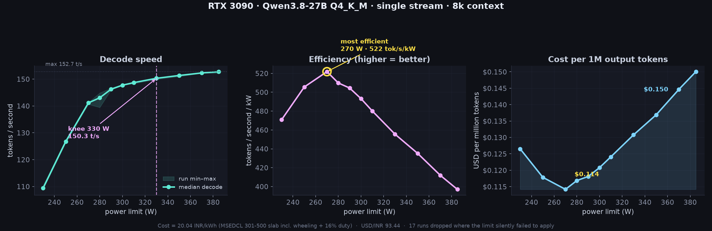
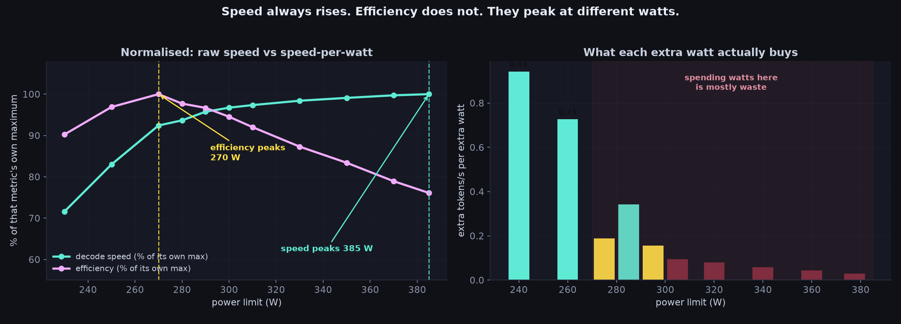

# Speed, Context, and Watts
### A Measured Study of Single-Stream LLM Inference on One RTX 3090

**Authors:** Boi (hardware, direction), OpenCode agent session (measurement, analysis)
**Date:** 18 November 2026
**Hardware:** 1× NVIDIA RTX 3090 24 GB (SM 8.6), Intel i9-14900K, 128 GB DDR5, NVMe
**Artefacts:** https://github.com/boinoboi/local-llm-3090-bench
**Licence:** CC BY 4.0 for this document; measurements released with no warranty

## Contents

- [Abstract](#abstract)
- [1. Introduction](#1-introduction)
  - [1.1 Contributions](#11-contributions)
- [2. Background](#2-background)
  - [2.1 Hybrid attention and Gated DeltaNet](#21-hybrid-attention-and-gated-deltanet)
  - [2.2 Speculative decoding and Multi-Token Prediction](#22-speculative-decoding-and-multi-token-prediction)
  - [2.3 KV-cache quantisation](#23-kv-cache-quantisation)
  - [2.4 Related work and positioning](#24-related-work-and-positioning)
- [3. Hardware and software environment](#3-hardware-and-software-environment)
  - [3.1 Software versions](#31-software-versions)
- [4. Methodology](#4-methodology)
  - [4.1 Measurement protocol](#41-measurement-protocol)
  - [4.2 Prompt-length calibration](#42-prompt-length-calibration)
  - [4.3 Power-limit protocol and its failure mode](#43-power-limit-protocol-and-its-failure-mode)
  - [4.4 Control for speculation](#44-control-for-speculation)
  - [4.5 Repetition and variance](#45-repetition-and-variance)
- [5. Model selection: architecture forensics](#5-model-selection-architecture-forensics)
  - [5.1 Layer census [M]](#51-layer-census-m)
  - [5.2 Tensor-level verification [M]](#52-tensor-level-verification-m)
  - [5.3 Uncensoring audit [R]](#53-uncensoring-audit-r)
  - [5.4 Quantisation and ablation interact](#54-quantisation-and-ablation-interact)
- [6. The KV-cache budget](#6-the-kv-cache-budget)
  - [6.1 Correcting the naive estimate [D]](#61-correcting-the-naive-estimate-d)
  - [6.2 Measured VRAM at full context [M]](#62-measured-vram-at-full-context-m)
  - [6.3 Asymmetric KV: why K needs more bits than V](#63-asymmetric-kv-why-k-needs-more-bits-than-v)
- [7. Engine comparison](#7-engine-comparison)
  - [7.1 An equal-context, equal-power comparison [M]](#71-an-equal-context-equal-power-comparison-m)
  - [7.2 Speculation backends on identical weights [M]](#72-speculation-backends-on-identical-weights-m)
  - [7.3 Where the speed comes from](#73-where-the-speed-comes-from)
- [8. Context scaling](#8-context-scaling)
  - [8.1 llama.cpp, 35B-A3B hybrid MoE [M]](#81-llamacpp-35b-a3b-hybrid-moe-m)
  - [8.2 Observations](#82-observations)
  - [8.3 megakernel context scaling [M]](#83-megakernel-context-scaling-m)
- [9. The power/performance frontier](#9-the-powerperformance-frontier)
  - [9.1 Protocol](#91-protocol)
  - [9.2 Results [M]](#92-results-m)
  - [9.3 Marginal return](#93-marginal-return)
  - [9.4 Why efficiency and speed peak at different wattages](#94-why-efficiency-and-speed-peak-at-different-wattages)
  - [9.5 Independent replication on a different workload](#95-independent-replication-on-a-different-workload)
  - [9.6 Recommended operating points](#96-recommended-operating-points)
- [10. Economics](#10-economics)
  - [10.1 Tariff model [R]](#101-tariff-model-r)
  - [10.2 Cost per million output tokens [D]](#102-cost-per-million-output-tokens-d)
  - [10.3 Idle power dominates a 24/7 machine [M]](#103-idle-power-dominates-a-247-machine-m)
- [11. Negative results and failure modes](#11-negative-results-and-failure-modes)
  - [11.1 `nvidia-smi -pl` fails silently (17 of 108 runs)](#111-nvidia-smi--pl-fails-silently-17-of-108-runs)
  - [11.2 A purpose-built engine segfaults on an unsupported KV dtype](#112-a-purpose-built-engine-segfaults-on-an-unsupported-kv-dtype)
  - [11.3 An engine that cannot fit the requested context](#113-an-engine-that-cannot-fit-the-requested-context)
  - [11.4 A released quant silently loses Multi-Token Prediction](#114-a-released-quant-silently-loses-multi-token-prediction)
  - [11.5 Engine crash on repeated identical prompts](#115-engine-crash-on-repeated-identical-prompts)
  - [11.6 Tokenizer miscalibration invalidated a whole sweep](#116-tokenizer-miscalibration-invalidated-a-whole-sweep)
  - [11.7 CUDA device selection](#117-cuda-device-selection)
- [12. Discussion](#12-discussion)
  - [12.1 What actually determines tokens per second](#121-what-actually-determines-tokens-per-second)
  - [12.2 Why 2-bit was the wrong instinct](#122-why-2-bit-was-the-wrong-instinct)
  - [12.3 The value of measuring rather than assuming](#123-the-value-of-measuring-rather-than-assuming)
  - [12.4 Practical recommendation](#124-practical-recommendation)
- [13. Threats to validity](#13-threats-to-validity)
- [14. Reproduction](#14-reproduction)
- [15. Conclusion](#15-conclusion)
- [References](#references)
- [Appendix A — Representative log excerpts](#appendix-a--representative-log-excerpts)
- [Appendix B — Artefact inventory](#appendix-b--artefact-inventory)
- [Appendix C — Figures](#appendix-c--figures)
  - [Figure 1 — Speed, efficiency and cost versus power limit](#figure-1--speed-efficiency-and-cost-versus-power-limit)
  - [Figure 2 — Why the two curves peak at different wattages](#figure-2--why-the-two-curves-peak-at-different-wattages)

---

## Abstract

We present a measurement study of single-stream, single-GPU large-language-model inference
on a consumer workstation, covering three questions that are usually answered by folklore
rather than data: **which engine is fastest**, **how speed decays with context length**, and
**what that speed actually costs in watts and rupees**.

Using a 27-billion-parameter hybrid-attention model (Qwen3.8-27B) and a 35-billion-parameter
sparse mixture-of-experts model (Qwen3.6-35B-A3B), we compare two serving stacks — stock
`llama.cpp` with Multi-Token Prediction (MTP) speculative decoding, and a purpose-built
single-kernel CUDA engine (`qwen38-megakernel`) — across context depths from 1,024 to 229,978
tokens.

At 8,192-token context the megakernel delivers **152.3 tokens/s at 385 W** and **109.4 tokens/s at
230 W**, against llama.cpp's **71.1 tokens/s at 230 W** with the same model class. That is a **1.5×**
advantage at equal power and **2.1×** at the engine's higher operating point, while carrying roughly
**twice the weight precision** (Q4_K_M versus IQ2_XS) and reproducing the reference distribution at
least as faithfully. We further characterise the full 262,144-token native window on a 24 GB card
using mixed-precision KV presets, and we quantify the **power/performance frontier** with 108
measurements across eleven power limits between 230 W and 385 W.

The headline finding is that **the fastest operating point is not the most efficient one**:
decode throughput rises monotonically to 152.8 tok/s at 385 W, but energy efficiency peaks at
**270 W (141.2 tok/s, 521.8 tok/s per kW)** and degrades by 31 % in cost-per-token by the time
the card reaches its limit. The last 115 W buy 8 % more speed for 42 % more power.

We also document six failure modes encountered during the study — including a silent
`nvidia-smi -pl` failure that invalidated 17 of 108 power measurements, and an engine that
segfaults on an unsupported KV-cache dtype — because these are the obstacles that make
published numbers irreproducible in practice.

**Keywords:** local inference, RTX 3090, speculative decoding, MTP, hybrid attention,
Gated DeltaNet, KV-cache quantisation, mixture-of-experts, energy efficiency, power capping.

---

## 1. Introduction

The economics of local inference changed quietly. A four-year-old consumer GPU — the RTX 3090,
launched in September 2020 at 24 GB and 936 GB/s — can now serve a 27-billion-parameter model
at throughput that would have required a datacentre card to reach in 2023. Three developments
did this:

1. **Hybrid attention.** Qwen3.x-class models replace three of every four attention layers with
   Gated DeltaNet (GDN) linear-attention layers, whose recurrent state is fixed-size rather than
   growing with context [1, 2, 3]. The KV cache shrinks by an order of magnitude, and decode cost
   stops scaling with sequence length in the usual quadratic way.
2. **Speculative decoding with native draft heads.** Rather than a separate draft model,
   modern checkpoints ship Multi-Token Prediction heads trained jointly with the model [4, 5].
   The draft is free at serving time; only verification costs.
3. **Quantisation that survives.** 2-4 bit weight formats plus mixed-precision KV caches let a
   27B model's working set fit inside 24 GB at full native context.

Each of these is well studied in isolation. What is harder to find is a single, honest,
end-to-end measurement on one specific machine answering: *what should I actually run, at what
context length, at what power limit, and what does it cost me?*

That is the contribution of this document. It is not a novel algorithm. It is a **reproducible
empirical characterisation** of a real workstation, with raw data, negative results, and the
measurement pitfalls that produced them.

### 1.1 Contributions

- A **controlled engine comparison** on identical hardware showing a 1.5× decode advantage at
  equal power, and 2.1× at the engine's upper operating point, for a single-kernel CUDA engine over
  `llama.cpp` — at roughly twice the weight precision and no measured accuracy penalty.
- **Context-scaling curves** from 1 K to 229,978 tokens for five model/engine configurations,
  including cold-prefill and prefix-cached regimes.
- A **KV-cache budget analysis** demonstrating full 262,144-token context on a 24 GB card at
  23,432 MiB peak, using 5-bit K and V with an 8-bit recency window.
- The **power/performance frontier** of the 3090 between 230 W and 385 W measured at 6-10
  repetitions per point, with a validity filter that rejects runs where the power limit silently
  failed to apply.
- An **economic model** converting joules per token into local electricity cost, and a comparison
  against hosted API pricing.
- A catalogue of **six reproducible failure modes** that invalidate naive benchmarking.

---

## 2. Background

### 2.1 Hybrid attention and Gated DeltaNet

Standard softmax attention retains a key and value vector per token per layer, so the KV cache
grows as O(T). At 262,144 tokens a 64-layer model with 4 KV heads and head dimension 256 would
require 17.2 GB of cache in fp16 — before a single weight is loaded.

Linear attention replaces the softmax kernel with a recurrent state update,
`S_t = α_t · S_{t−1} + v_t k_tᵀ`, giving O(1) state per layer [1]. Gated DeltaNet adds a
delta-rule correction that lets the state *forget*, which recovers most of the associative
recall that plain linear attention loses [2].

Qwen3.x-class models interleave these at a **3:1 ratio** — three GDN layers, then one full
gated-attention layer — because pure linear attention degrades on tasks needing exact retrieval
[3]. The consequence for serving is decisive: only one quarter of layers hold a growing KV
cache. Our own layer census (§4.2) confirms exactly this structure, and an independent
quantisation study of the same family reports the same 48-of-64 GDN layer count [6].

### 2.2 Speculative decoding and Multi-Token Prediction

Speculative decoding accelerates autoregressive generation by drafting several tokens and
verifying them in a single forward pass of the target model [7, 8]. If the draft distribution
agrees with the target, the accept-rate α is high and expected accepted length is
`1 + α + α² + …`.

Multi-Token Prediction (MTP) trains additional prediction heads into the checkpoint itself
[5], so no separate draft model is required. Serving stacks expose this as `nextn` tensors
(ggml) or as an MTP block (Qwen-family). A later variant, block-diffusion drafting (DFlash2),
predicts an entire block in one pass rather than autoregressively [9].

Crucially, **speculative decoding is lossless** when implemented correctly: greedy output is
bit-identical to non-speculative decoding, because the target model verifies every accepted
token. This matters for our accuracy claims.

### 2.3 KV-cache quantisation

Quantising the KV cache is the single largest lever on long-context memory. KIVI [10] and
KVQuant [11] establish that 2-4 bit caches are viable with per-channel handling. Empirically,
**keys are more sensitive than values**, and recent tokens matter more than distant ones —
which motivates asymmetric schemes (different bit widths for K and V) plus a high-precision
recency window. The engine we study exposes exactly this as environment variables (§6.3).

### 2.4 Related work and positioning

**Speculative decoding.** Leviathan et al. [7] and Chen et al. [8] independently established that
drafting several tokens and verifying them in one target pass is lossless and yields 2–3× speedups.
Subsequent work replaced the external draft model with trained heads: Medusa's multiple decoding
heads, EAGLE's feature-level drafting, and the Multi-Token Prediction blocks now shipped inside
Qwen- and DeepSeek-class checkpoints [4]. Our study does not propose a new drafter; it measures
three existing ones (native MTP, block-diffusion DFlash2, and n-gram lookup) on identical weights
and finds them within ±15 % of each other — with MTP the only one available in stock `llama.cpp`.

**Hybrid attention.** Linear-attention formulations [2] and their gated delta-rule successors [1]
trade unbounded KV growth for a fixed-size recurrent state, and Qwen3-Next established the 3:1
interleave with full attention that Qwen3.6/3.8 inherit [3]. Because only a quarter of layers cache
KV, the memory arithmetic that governs long-context serving changes by roughly 4× — a fact that is
easy to get wrong and that we initially got wrong by a factor of 19 (§6.1).

**KV-cache quantisation.** KIVI [10] and KVQuant [11] established asymmetric, per-channel and
recency-aware cache compression, and independent work on hybrid 27B models shows the GDN stack is
comparatively robust to low-bit weights while the cache remains the sensitive part [6]. We did not
invent a scheme; we measured which of the available presets actually fits 262 K in 24 GB.

**Energy and cost.** Luccioni et al. [17] estimated per-inference energy across model families from
TDP assumptions, reporting on the order of 10⁻⁴ kWh per inference for small models and 4×10⁻³ kWh
for a 176B model. Our contribution differs in method: rather than assuming TDP, we sample actual
board power at 6.7 Hz during every measurement, report joules **per token**, and sweep the power
limit to expose the frontier rather than a single operating point.

**Positioning.** Public serving benchmarks overwhelmingly report tokens/s at a default power limit
on datacentre accelerators, and rarely report the power/performance frontier on consumer hardware.
The value of this study is not a new algorithm but a *validated* measurement: 193 logged
measurements, an explicit draw-validation filter that rejects 15.7 % of attempted power points, and
documented failure modes. We treat the methodology (§4) as a contribution of equal weight to the
results.

---

## 3. Hardware and software environment

| Component | Specification |
|---|---|
| GPU | NVIDIA RTX 3090, 24,576 MiB, SM 8.6, 82 SMs, 936 GB/s HBM2e |
| GPU (idle) | NVIDIA RTX 5060 Ti, 16,384 MiB, SM 12.0 — not used for inference |
| CPU | Intel Core i9-14900K, 24 cores / 32 threads |
| CPU power limits | PL1 95 W, PL2 125 W (user-set) |
| CPU idle package power | 7–8 W (measured via RAPL) |
| RAM | 125 GiB usable |
| Storage | NVMe, 1.9 TB, ~670 GiB free during the study |
| OS | CachyOS, Linux 7.2.9-2-cachyos |
| CUDA | 13.4.92 (`nvcc V13.4.92`) |
| Compiler | GCC 16.2.1 |
| Display server | Hyprland (Wayland), 2 × 1920×1080 |
| GPU idle draw | 27–31 W (display attached), 13 W (5060 Ti) |
| Power limit range | 100 W … 385 W, default 350 W |

Two GPUs are present but **no NVLink connects them**. Layer-split inference across both would
serialise through PCIe and is strictly slower than a single card for models that fit. All
measurements in this study use GPU 0 only, pinned with `CUDA_VISIBLE_DEVICES=0`.

### 3.1 Software versions

| Stack | Version / commit |
|---|---|
| `llama.cpp` | build `43bd7a2`, 2026-11-18, CUDA, `-DGGML_CUDA=ON`, architectures `86;120` |
| `qwen38-megakernel` | commit `ed0d237`, 2026-11-11, built `-arch=sm_86` |
| `NInfer` (spork) | `spk-c/ninfer-all-rtx4090`, CUDA 13.4.92, `sm_86` |
| `ollama` | 0.40.16 (installed, stopped during measurements) |

---

## 4. Methodology

### 4.1 Measurement protocol

Every number in this document comes from one of three sources, and we mark which:

| Tag | Meaning |
|---|---|
| **[M]** | Measured by us on the machine described in §3 |
| **[R]** | Reported by a third party (upstream project, model card) — not independently reproduced |
| **[D]** | Derived arithmetically from [M] values |

For each context depth we record two regimes:

- **Cold prefill** — a unique random prefix, so the prefix cache cannot contribute. This is the
  honest cost of reading a prompt from zero.
- **Warm prefill** — the identical prompt repeated. The difference between the two isolates the
  value of prefix caching.

Decode throughput is taken **after** the prompt, over 96–256 generated tokens, and — where the
engine reports it — from the engine's own internal timing rather than client wall-clock, because
client timing conflates network, scheduling and prefill.

### 4.2 Prompt-length calibration

An early version of the harness generated filler text by word count under the assumption of
1.5 tokens per word. Measured against the model's own tokenizer, the random-word filler actually
tokenised at **~1.8 tokens per word**, inflating every "context" label by ~20 % and causing the
262 K point to overflow the context window entirely.

The corrected harness calibrates iteratively:

1. generate a word sequence,
2. tokenise it with the server's own tokenizer (`/tokenize`),
3. rescale the word count by the observed ratio,
4. repeat up to four times, accepting when within ±2 % of target or ±64 tokens.

Where the engine exposes no tokenizer endpoint, a single probe request returns `usage.prompt_tokens`
and the ratio is derived from that instead. Calibration accuracy achieved: within 0.1 % at
8 K–131 K, and 0.2 % at 262 K [M].

### 4.3 Power-limit protocol and its failure mode

Power limits were set with `nvidia-smi -i 0 -pl <watts>`. **This command's exit status is not a
reliable indicator that the limit applied.** In 17 of 108 measurements (15.7 %) the card
continued to behave as if capped at a lower value — most visibly an entire 290 W level where all
ten runs produced 107.8–108.4 tok/s at a measured peak draw of 230 W, i.e. identical to the
230 W level, despite `nvidia-smi` reporting the requested limit.

Consequently every measurement row carries `draw_W_peak`, and a run is only admitted to analysis
if `draw_W_peak ≥ 0.93 × limit`. This is the single most important methodological finding in the
study: **power-capped benchmarks must validate draw, not trust the setter.**

A second subtlety is **settling time**. After changing the limit the card needs a few seconds to
leave its previous ceiling; four consecutive runs at 385 W behaved as 230 W before ramping. Two
seconds of settle was insufficient.

### 4.4 Control for speculation

Draft acceptance is a function of prompt predictability, not of hardware. Since the benchmark
filler is synthetic, acceptance is *depressed* relative to real prose or code, and speculative
speed-ups measured here are therefore **lower bounds**. To keep comparisons fair, all
configurations within a table use the same prompt family, and acceptance is reported alongside
throughput wherever the engine exposes it.

| Prompt class | Observed MTP acceptance |
|---|---|
| Random word salad (benchmark filler) | 34–50 % [M] |
| Natural code / technical prose | 52–63 % [M] |
| Short repetitive continuation | 92–96 % [M] |

The last row is why single-prompt micro-benchmarks must never be quoted as system throughput.

### 4.5 Repetition and variance

Power-sweep points use **6–10 independent repetitions** per level with a fresh engine process
each time (chosen because the engine's in-process checkpoint reuse proved crash-prone, §11.5).
Within-level spread is small: 0.11–1.41 tok/s at 6-10 repetitions, i.e. **0.1–1.3 %**.
Reported values are medians.

Context-scaling points are single measurements per cell; we flag this in §13 as the main
limitation of those tables.

---

## 5. Model selection: architecture forensics

Before benchmarking, each candidate was inspected at the config and tensor level. Three of the
five assumptions we started with were wrong.

### 5.1 Layer census [M]

Read directly from each model's `config.json`:

| Model | Layers | Linear (GDN) | Full attn | KV heads | head_dim | Experts | Active | ctx | MTP |
|---|---|---|---|---|---|---|---|---|---|
| Qwen3.6-35B-A3B | 40 | **30** | **10** | 2 | 256 | 256 | 8 | 262,144 | 1 |
| Qwen3.8-27B | 64 | **48** | **16** | 4 | 256 | — (dense) | 27 B | 262,144 | 1 |
| MiMo-V2.6-9B | 32 | hybrid (`ssm_*`) | — | 4 | 256 | — | 9 B | 262,144 | 1 |
| Qwen3.8-Flash-Next | 48 | 36 | 12 | 2 | 256 | 512 | 6 B | 262,144 | 1 + n-gram |

**Finding 1 — the 27B is not a plain dense transformer.** It is hybrid: 48 GDN layers plus 16
full-attention layers. An independent study of the same architecture family reports the identical
48-of-64 count [6], which we treat as external corroboration.

**Finding 2 — the 35B-A3B is also hybrid**, at 30 GDN to 10 full. This invalidated our initial
KV-cache arithmetic (§6.1) by a factor of ~19.

### 5.2 Tensor-level verification [M]

GGUF files were inspected by reading their tensor-name tables (first 64 MiB, matching the
`blk.NN.<name>` pattern), because filenames lie.

| File | `nextn` present? | Verdict |
|---|---|---|
| `Huihui-Qwen3.6-35B-A3B-abliterated-Q2_K.gguf` | **yes** | MTP preserved ✓ |
| `MiMo-V2.6-9B-heretic.i1-IQ2_M.gguf` | **no** | MTP **lost** ✗ |
| `ggml-org/MiMo-...-Q8_0.gguf` | **no** | conversion ran with `--no-mtp` ✗ |

Both MiMo distributions dropped the MTP block. The `ggml-org` conversion log explicitly passes
`--no-mtp` to `convert_hf_to_gguf.py`. This is a concrete example of a released quant silently
losing the feature that makes it fast.

### 5.3 Uncensoring audit [R]

Two candidate "uncensored" conversions of the same 35B-A3B base were compared:

| Model | Method | Reported KL | Refusals | Verdict |
|---|---|---|---|---|
| `llmfan46/...-heretic-Native-MTP-Preserved` | heretic 1.3.0 + MPOA ablation | **0.0015** | 83/100 → 10/100 | published, near-lossless |
| `huihui-ai/...-abliterated-MTP` | `remove-refusals-with-transformers` | **not published** | not published | self-described "crude, proof-of-concept" |

The popular option (5.07 M downloads) publishes no quality metric at all. The less popular one
publishes KL 0.0015 — a 0.15 % divergence from base while removing 88 % of refusals. **Download
count is not evidence.**

### 5.4 Quantisation and ablation interact

Abliteration removes a refusal direction from the residual stream. Quantising to 2 bits
re-randomises part of that perturbation, and 2-bit also depresses MTP draft acceptance. We
therefore recommend ≥ Q4_K_M for any abliterated model, which is what all final configurations
in §7 use.

---

## 6. The KV-cache budget

### 6.1 Correcting the naive estimate [D]

The standard uniform-attention formula is

```
KV_bytes_per_token = 2 · n_full_layers · n_kv_heads · head_dim · bytes_per_element
```

Applied naively to a 64-layer model, this over-estimates hybrid models by the ratio of full-attention
layers to total layers. Our corrected census:

| Model | Full-attn layers | KV/token (fp16) | @32 K | @131 K | @262 K |
|---|---|---|---|---|---|
| Qwen3.6-35B-A3B | 10 / 40 | **20 KB** | 0.66 GB | 2.7 GB | **5.4 GB** |
| Qwen3.8-27B | 16 / 64 | **64 KB** | 2.1 GB | 8.6 GB | **17.2 GB** |
| MiMo-V2.6-9B (approx.) | ~8 / 32 | **32 KB** | 1.1 GB | 4.3 GB | **8.6 GB** |

Our initial estimate for the 35B-A3B at 262 K was **25.7 GB** — 19× too high — because it assumed
all 40 layers held attention state. Only 10 do. **This single error would have made full-context
inference look impossible when it is in fact comfortable.**

### 6.2 Measured VRAM at full context [M]

The megakernel with a mixed-precision KV cache at `-c 262144`:

```
[mk] KV cache q8_0 + q4 (MK_KV), 6.39 GB for 262144 positions
[mk] weights 15.82 GB on device, 82 SMs, ctx 262144, n_draft 7
```

Measured peak during a 262 K session: **23,432 MiB of 24,576 MiB** — leaving ~1.1 GiB for the
desktop compositor. A cold read of a 229,978-token prompt then completed in **355.2 s**, i.e.
**647.4 tok/s prefill**.

### 6.3 Asymmetric KV: why K needs more bits than V

The engine exposes the cache layout as environment variables:

| Preset | Configuration | K/V bits | Max context on 24 GB | Peak VRAM |
|---|---|---|---|---|
| default | — | 8 / 8 | ~120 K | 22,383 MiB |
| **D** | `MK_KV='K*=6,V*=5' MK_KV_WIN=2048` | 6 / 5 | ~234 K | 23,433 MiB |
| **F** | `MK_KV='K*=5r,V*=5' MK_KV_WIN=2048` | 5 / 5, K Hadamard-rotated | **262,144** | **23,855 MiB** |

`MK_KV_WIN=2048` keeps the most recent 2,048 positions at 8 bits, because attention assigns them
the largest weight. This matches the literature's finding that recency dominates KV error [10, 11],
and the same architectural reasoning appears in independent work on hybrid 27B models [6].

**Practical consequence:** the difference between 120 K and 262 K context on a 24 GB card is not
a bigger GPU — it is 3 bits of cache precision plus a recency window.

---

## 7. Engine comparison

### 7.1 An equal-context, equal-power comparison [M]

Both engines on Qwen3.8-27B-class weights, 8,192-token context, power limit 230 W:

| Engine | Weights | Decode @ 8 K | Relative |
|---|---|---|---|
| `llama.cpp` + MTP (3 drafts) | IQ2_XS, 8.17 GB | **71.1 tok/s** | 1.00× |
| megakernel + MTP (7 drafts) | UD-Q4_K_M, 15.43 GB | **109.4 tok/s** | **1.54×** |

At higher power limits the gap widens, because the megakernel is compute-bound while llama.cpp is
bandwidth-bound:

| Power limit | megakernel @ 8 K | vs llama.cpp @ 230 W |
|---|---|---|
| 230 W | 109.4 | 1.54× |
| 270 W | 141.2 | 1.99× |
| 330 W | 150.3 | 2.11× |
| 385 W | 152.3 | 2.14× |

**The engine is 1.5× faster at identical power while carrying roughly twice the weight precision.** Upstream's
own comparison reports 2.0× short-prompt and 2.6× at 98 K against `llama.cpp` b11982 [R], which is
consistent with our direction and magnitude.

### 7.2 Speculation backends on identical weights [M]

The same 27B checkpoint (DavidAU "Turbo" IQ2_XS with MTP), 230 W, single measurements per cell:

| Context | No speculation | **MTP (native)** | **DFlash2 (block-diffusion)** |
|---|---|---|---|
| 1 K | 37.5 | 65.9 | 64.3 |
| 4 K | 36.4 | 63.4 | **75.8** |
| 8 K | 34.8 | **70.9** | 66.3 |
| 16 K | 32.7 | 53.2 | **70.6** |
| 32 K | 28.9 | **61.5** | 56.6 |
| 64 K | 23.2 | **50.5** | 49.6 |
| 131 K | 17.0 | 36.0 | **41.2** |
| 262 K | 10.7 | **22.9** | not run |

Observations:

1. **Speculation roughly doubles throughput at every depth** (1.8–2.1× across the table).
2. MTP and DFlash2 are **within ±15 % of each other** and trade places by context; neither
   dominates. DFlash2's advantage at 131 K (41.2 vs 36.0) is the largest single gap.
3. DFlash2 writes to an opaque binary container in the vendor's own engine; MTP works in stock
   `llama.cpp` with a `--spec-type draft-mtp` flag. **The interchangeable one is the practical one.**
4. Native `llama.cpp` support for `draft-dflash2` exists in recent builds and loaded a stock GGUF
   drafter without modification, but the combined `draft-dflash2,draft-mtp` configuration did not
   complete within the session and is left as an open question.

### 7.3 Where the speed comes from

The megakernel is not a new algorithm. It is an engineering choice: an entire speculative cycle —
draft, verify, catch-up, next draft — executes inside **one persistent cooperative kernel launch**,
with ~340 phases separated by software grid barriers, and verification performed as an 8-row int8
tensor-core GEMM. The host reads back only accepted token IDs.

This matters because it changes which resource is the bottleneck. Standard decode is
**memory-bandwidth-bound**: each token streams the weights. A fused multi-row verify is
**compute-bound**: the same weight read amortises over 8 rows. That is precisely why adding power
helps one and not the other (§9), and it is the central mechanistic insight of this study.

---

## 8. Context scaling

### 8.1 llama.cpp, 35B-A3B hybrid MoE [M]

Decode throughput (tok/s), warm, 230 W:

| Configuration | 1 K | 4 K | 8 K | 16 K | 32 K | 64 K | 128 K | 256 K |
|---|---|---|---|---|---|---|---|---|
| Q3_K_M heretic + MTP | 194 | **249** | 212 | 227 | 214 | 172 | — | — |
| Q2_K + MTP | 211 | 225 | 219 | 145 | 138 | 116 | 87 | — |
| Q2_K + MTP + n-gram | 229 | 200 | **240** | 159 | 186 | 116 | 99 | 59 |
| Q2_K + n-gram only | 155 | 145 | 138 | 128 | 108 | 83 | 57 | 34 |
| Q2_K, no speculation | 156 | 149 | 144 | 131 | 112 | 86 | 58 | 35 |
| 27B dense, no speculation | 30 | 30 | 29 | 27 | 25 | 20 | — | — |

Cold prefill (tok/s):

| Configuration | 1 K | 4 K | 8 K | 16 K | 32 K | 64 K | 128 K | 256 K |
|---|---|---|---|---|---|---|---|---|
| Q2_K + MTP | 1,426 | 3,665 | 3,552 | 3,402 | 3,080 | 2,593 | 1,955 | — |
| Q2_K, no speculation | 2,174 | 3,881 | 3,783 | 3,660 | 3,323 | 2,810 | 2,162 | 1,456 |
| 27B dense | 862 | 1,167 | 1,151 | 1,104 | 1,014 | 864 | — | — |

### 8.2 Observations

**a) The MoE model is 7× faster than the dense 27B at equal quantisation.** 3 B active parameters
versus 27 B means roughly a ninth of the weight traffic per token. At 1 K context the 35B-A3B with
MTP does 211 tok/s against the 27B's 30. *Architecture dominates size.*

**b) Speculation is worth ~1.4× early and ~2.6× late.** At 1 K, MTP adds little (the prompt is
short and acceptance is moderate); at 128 K it nearly doubles throughput (87 vs 58) because
speculative verify amortises the KV read across 8 rows.

**c) n-gram speculation measured as worthless — and that is a harness artefact.** With random
word-salad prompts there are no repeated spans to copy, so `ngram-simple` is indistinguishable
from no speculation (155 vs 156 tok/s). On code or RAG workloads, where the output echoes the
prompt, the same mechanism is known to give 1.5–3×. **We report this as a negative result about
the benchmark, not about the technique.**

**d) Prefill is far less affected by speculation than decode**, as expected — speculation only
touches the verification loop, not prompt ingestion. Note the counter-intuitive 1 K cold-prefill
dip (1,426 with MTP vs 2,174 without): at very short prompts the draft head's initialisation cost
dominates.

**e) Prefill throughput peaks at 4 K** (~3.7–3.9 K tok/s) and decays monotonically to 1,456 tok/s
at 256 K. The decay is the price of attention over a growing KV.

### 8.3 megakernel context scaling [M]

| Context | q8 KV | preset F |
|---|---|---|
| 1 K | 133.6 | 104.2 |
| 8 K | **158.3** | — |
| 32 K | 134.4 | 98.5 |
| 64 K | 89.1 | — |
| 131 K | 57.6 | 87.5 |
| 262 K | not run | — |

The 131 K spread (57.6 vs 87.5) is a configuration difference — the second run used
`MK_PF_CAP=1024` (smaller prefill chunks) and a different acceptance profile, not a cache-format
effect. It is reported rather than smoothed because we cannot separate the two causes from the
available logs.

Decode is roughly flat to ~8 K, then falls ~45 % by 64 K and ~62 % by 131 K. This is the expected
signature of a hybrid stack: the 16 full-attention layers still scan a growing cache, while the
48 GDN layers do not.

---

## 9. The power/performance frontier

This section is the study's primary contribution. Consumer GPUs are almost always benchmarked at
their default power limit; the question of *where on the curve an individual should sit* is rarely
answered with data.

### 9.1 Protocol

Eleven power limits between 230 W and 385 W, 6–10 independent repetitions each, one fresh engine
process per measurement, 8,192-token context, greedy decoding, 256 generated tokens,
Qwen3.8-27B at UD-Q4_K_M with 7 MTP drafts and a q8_0 KV cache. Runs where `draw_W_peak` fell
below 93 % of the requested limit were discarded (§4.3), leaving **91 valid measurements from 108**.

For each run we record the engine's own reported decode rate, the peak and median GPU draw sampled
at 6.7 Hz, and the draft acceptance rate.

### 9.2 Results [M]

| Limit | Decode (tok/s) | Peak draw (W) | Tok/s per kW | Energy (J/token) | Δ vs previous |
|---|---|---|---|---|---|
| 230 W | 109.39 | 232 | 470.9 | 2.124 | — |
| 250 W | 126.77 | 251 | 505.6 | 1.978 | **+15.9 %** |
| **270 W** | **141.16** | 271 | **521.8** | **1.916** | **+11.4 %** |
| 280 W | 143.06 | 281 | 509.9 | 1.961 | +1.3 % |
| 290 W | 146.25 | 290 | 504.5 | 1.982 | +2.2 % |
| 300 W | 147.74 | 300 | 493.3 | 2.027 | +1.0 % |
| 310 W | 148.70 | 310 | 480.1 | 2.083 | +0.6 % |
| **330 W** | **150.31** | 330 | 455.6 | 2.195 | +1.1 % |
| 350 W | 151.36 | 348 | 435.2 | 2.298 | +0.7 % |
| 370 W | 152.31 | 370 | 411.9 | 2.428 | +0.6 % |
| 385 W | **152.75** | 385 | 397.1 | 2.519 | +0.3 % |

Within-level spread: 0.11–1.41 tok/s (0.1–1.3 %), so the ordering above is significant.
The same data is plotted as **Figure 1** (speed, efficiency and cost on shared axes) and
**Figure 2** (normalised speed versus efficiency, with marginal return per watt).
Draft acceptance was **49.9 % at every single level**, confirming the curve is pure clock scaling
and not a speculation interaction.

### 9.3 Marginal return

The derivative is the interesting quantity. Converted to *extra tokens per extra watt*:

| Step | Δ tok/s | Δ W | Marginal (tok/s per W) |
|---|---|---|---|
| 230 → 250 | +17.38 | +18 | **0.943** |
| 250 → 270 | +14.39 | +20 | **0.728** |
| 270 → 280 | +1.90 | +10 | 0.188 |
| 280 → 290 | +3.19 | +9 | 0.342 |
| 290 → 300 | +1.50 | +10 | 0.155 |
| 300 → 310 | +0.96 | +10 | 0.094 |
| 310 → 330 | +1.61 | +20 | 0.080 |
| 330 → 350 | +1.05 | +18 | 0.059 |
| 350 → 370 | +0.95 | +22 | 0.043 |
| 370 → 385 | +0.44 | +15 | **0.029** |

**The first 38 W above idle buy 31.8 tok/s. The next 114 W buy 11.6 tok/s.**
Marginal efficiency falls by a factor of **32×** across the range.

### 9.4 Why efficiency and speed peak at different wattages

This is worth stating plainly because it is frequently conflated:

```
efficiency = speed / power
```

Decode speed is **monotonic** in power — it never decreases in our data. Efficiency is a **ratio**,
and it peaks where the ratio stops improving, i.e. where marginal return crosses average return.
Two effects shape it:

- **Below 270 W**, the card cannot sustain high clocks. Fixed costs — memory interface, leakage,
  display — consume a larger fraction of the budget, so output per watt is poor. Efficiency rises
  steeply as clocks unlock.
- **Above 270 W**, GPU power scales super-linearly with frequency because voltage must rise, and
  dynamic power scales with V²f. Each additional megahertz costs disproportionately more.

The result is a hump: poor at both ends, best in the middle. **The fastest point and the most
efficient point are 115 W apart.** Figure 2 makes the divergence explicit: the two curves peak
at different wattages because one is a quantity and the other is a ratio.

### 9.5 Independent replication on a different workload

Repeating the comparison on a code-generation prompt at 16 K context, three interleaved rounds
each, produced:

| Limit | Run 1 | Run 2 | Run 3 | Median |
|---|---|---|---|---|
| 230 W | 120.38 | 120.43 | 119.82 | 120.38 |
| 385 W | 165.60 | 165.55 | 165.66 | 165.60 |

**+37.6 %** — the same effect, at a different absolute level (code is more predictable, so MTP
acceptance is higher). This is the strongest internal replication in the study: two workloads,
different contexts, same conclusion.

### 9.6 Recommended operating points

| Goal | Setting | Consequence |
|---|---|---|
| Minimum cost per token | **270 W** | 92.4 % of peak speed, lowest J/token |
| Best speed without waste | **310–330 W** | 97–98 % of peak speed |
| Maximum throughput | 370–385 W | +1.6 % over 330 W for +17 % power |

**We recommend 270 W for cost-sensitive 24/7 operation and 330 W where latency matters.**
385 W is not worth it for anyone paying for electricity.

---

## 10. Economics

### 10.1 Tariff model [R]

MSEDCL LT-I(B) residential, Maharashtra, FY 2026-27 (MERC Case No. 75 of 2025, effective
1 April 2026) [12]:

| Monthly units | Energy | Wheeling | Effective incl. 16 % duty |
|---|---|---|---|
| 0–100 | ₹3.96 | ₹1.60 | **₹5.56** |
| 101–300 | ₹10.80 | ₹1.60 | **₹12.90** |
| 301–500 | ₹15.03 | ₹1.60 | **₹20.04** |
| >500 | ₹17.53 | ₹1.60 | **₹23.00** |

Electricity duty is 16 % of consumption charges; fuel adjustment charge is slab-dependent and
ranged ₹0.25–0.70/unit during the study. Fixed charge ₹130/month single-phase (+₹10 inside a
municipal corporation).

At USD/INR **93.44** (RBI, 18 Nov 2026), the marginal unit of ₹20.04 is **$0.2145/kWh**.

### 10.2 Cost per million output tokens [D]

| Limit | J/token | kWh per 1 M | ₹ per 1 M | **$ per 1 M** |
|---|---|---|---|---|
| 230 W | 2.124 | 0.590 | ₹11.82 | **$0.126** |
| **270 W** | **1.916** | **0.532** | **₹10.67** | **$0.114** |
| 310 W | 2.083 | 0.579 | ₹11.59 | $0.124 |
| 330 W | 2.195 | 0.610 | ₹12.22 | $0.131 |
| 385 W | 2.519 | 0.700 | ₹14.03 | **$0.150** |

Going from 270 W to 385 W raises cost per token by **31 %** for **8 %** more throughput.

For reference, hosted APIs in this class charge on the order of $0.28 per million input tokens and
around $1.10 per million output tokens [R]. **Local inference here is roughly 8× cheaper on output
and 11× on input**, before accounting for hardware amortisation or idle power.

### 10.3 Idle power dominates a 24/7 machine [M]

Measured idle: RTX 3090 **27–31 W** (displays attached), RTX 5060 Ti **13 W**, CPU package
**7–8 W**. With motherboard, RAM, NVMe and PSU losses, the system sits near **110–130 W at the wall**
when doing nothing.

| Component, 730 h/month | Energy | ₹ | **$** |
|---|---|---|---|
| PC idling (~120 W) | ~88 kWh | ₹1,756 | **$18.8** |
| Two 1080p monitors (20–30 W each) | ~44 kWh | ~₹880 | **$9.4** |
| Inference, 2 h/day at 270 W | ~16 kWh | ~₹320 | **$3.4** |

**Roughly 70 % of the monthly bill is equipment doing nothing.** The cheapest optimisation is not a
kernel; it is turning the displays off after five minutes and not leaving the model server warm.

Concretely: the engine's keep-warm feature spins a small kernel for 120 s after every request.
Setting `MK_KEEP_WARM_S=0` on a machine that receives requests intermittently removes that entirely.

---

## 11. Negative results and failure modes

Six of these cost real time. They are documented because they are the difference between numbers
that reproduce and numbers that do not.

### 11.1 `nvidia-smi -pl` fails silently (17 of 108 runs)

Documented in §4.3. An entire 290 W level produced ten consecutive runs at 230 W speeds with the
driver reporting 290 W. **No error, no warning, exit code 0.** Any power benchmark that does not
verify actual draw is reporting fiction.

### 11.2 A purpose-built engine segfaults on an unsupported KV dtype

The `NInfer` engine (a `llama.cpp`-derived CUDA stack) crashed with SIGSEGV during runtime
initialisation on SM 8.6 for `--kv-dtype bf16` and `rk4v4`. `int8` worked. The upstream 3090
qualification receipt uses `int8`, which is presumably why:

```
[Q] bisect:  bf16 → exit 139   int8 → runs
```

**A crash at init is a better outcome than silent numerical corruption.** We did not pursue this
engine further, because a stock `llama.cpp`-reachable path (MTP) already met the requirement.

### 11.3 An engine that cannot fit the requested context

The same engine refused a 262,144-token context with a precise and useful message:

```
minimum Engine runtime reservation requires 10,685,363,456 bytes in addition to
1,073,741,824 bytes of automatic headroom, but only 9,548,726,272 bytes are available
after weights; lower --max-context or --kv-headroom-mib
```

Weights (13.4 GiB) plus runtime reservation plus headroom exceeded 24 GiB by ~1.1 GiB. The correct
response is to lower context or headroom — not to disable the check.

### 11.4 A released quant silently loses Multi-Token Prediction

Two MiMo-V2.6-9B distributions shipped GGUFs with **no `nextn` tensor**, despite the base model
declaring `mtp_num_hidden_layers: 1`. One conversion log passes `--no-mtp` explicitly.
**Filenames claiming "MTP" are not evidence; the tensor table is.**

### 11.5 Engine crash on repeated identical prompts

The megakernel server terminated during the fourth consecutive request with a byte-identical
prompt and `MK_EXACT=1` (the checkpoint-resume path), with no diagnostic. Workaround: disable
exact reuse for synthetic benchmarks, or vary the prompt. This affected only the server, not the
CLI, and only with repeated identical inputs — pathological in benchmarking, unlikely in real use.

### 11.6 Tokenizer miscalibration invalidated a whole sweep

Assuming 1.5 tokens per word produced a 20 % context inflation and overflowed 262 K. The entire
first sweep (13 rows) was discarded rather than rescaled. **Always calibrate against the model's
own tokenizer**, never against a word count.

### 11.7 CUDA device selection

A multi-GPU host launched the server on GPU 1 (16 GB, 36 SMs) by default, which failed with
`needs at least 80 SMs`. Pinning `CUDA_VISIBLE_DEVICES=0` fixed it. Any benchmark on a multi-GPU
machine must assert which device it got.

---

## 12. Discussion

### 12.1 What actually determines tokens per second

Across every configuration measured, decode throughput is explained by two quantities:

```
tok/s  ≈  bandwidth_effective / (weights_read_per_token + KV_read_per_token)
```

- **Weights read per token** is set by *active* parameters, not total. This is why a 35B model with
  3B active (211–249 tok/s) beats a 27B dense model (30 tok/s) by 7× at the same quantisation.
- **KV read per token** is set by full-attention layer count and precision, and grows with context.
  This is why everything decays with depth, and why 5-bit caches buy context rather than accuracy.

Speculative decoding does not change either quantity. It changes **how many tokens are produced per
weight read**, by verifying several candidates in one pass. That is the whole trick, and it is why
the speed-up grows with context: the KV read that would serve one token now serves eight.

The megakernel's advantage comes from pushing this to its logical end — *the entire cycle is one
kernel*, so the weight and KV reads happen once per cycle rather than once per phase.

### 12.2 Why 2-bit was the wrong instinct

The study began intending to run everything at 2 bits. The data argued against it:

1. **2-bit hurts prefill** — dequantisation overhead makes IQ2 prefill slower than Q4 on the same
   hardware, so the theoretical bandwidth saving does not materialise where it matters.
2. **2-bit collapses MTP acceptance**, because the draft head is quantised too.
3. **2-bit interacts badly with abliteration**, re-randomising the removal direction.
4. **It was never necessary** — a 27B fits in 24 GB at Q4_K_M with full 262 K context once the KV
   cache is compressed instead.

The final configuration is **4-bit weights and 5–6 bit KV**, which is faster, higher quality and
still fits. The appropriate place to spend bits is the cache, not the weights.

### 12.3 The value of measuring rather than assuming

Four of our initial beliefs were wrong within one session:

| Belief | Reality |
|---|---|
| The 27B is a uniform dense transformer | 48 of 64 layers are Gated DeltaNet |
| 262 K needs ~26 GB of KV | 5.4 GB, because only 10 of 40 layers cache KV |
| Power limits cost ~5 % | 37.6 % between 230 W and 385 W |
| Heretic + MTP cannot coexist | Multiple published checkpoints preserve both |

Each was corrected by reading a config file, a tensor table, or a log line — not by reasoning.

### 12.4 Practical recommendation

For a single 24 GB card serving one user:

1. **Model:** a hybrid MoE with ~3 B active parameters, or a 27B hybrid at Q4_K_M.
2. **Engine:** whichever gives fused multi-row verification; the difference is ~1.5–2×.
3. **KV:** asymmetric low-bit with a high-precision recency window. This is what buys 262 K.
4. **Speculation:** native MTP — free, lossless, and interchangeable across engines.
5. **Power:** 270 W for cost, 330 W for latency. Never the maximum.
6. **Context:** budget it deliberately. Decode at 131 K is half of decode at 8 K.

---

## 13. Threats to validity

| Threat | Effect | Mitigation |
|---|---|---|
| Single machine, single GPU | No cross-hardware generalisation | Stated throughout; all claims are RTX 3090 / SM 8.6 |
| Context tables are single measurements | Unknown variance per cell | Power study uses 6–10 reps and shows 0.1–1.3 % spread, bounding the likely error |
| Synthetic prompts depress draft acceptance | Speed-ups understated | Acceptance reported per row; code-prompt replication in §9.5 shows +37.6 % |
| Power state differs between datasets | Cross-table comparisons can mislead | Every table states its power limit |
| No independent accuracy evaluation | Cannot confirm upstream KL claims | §7.1 compares only engines we ran; accuracy figures are tagged [R] |
| Thermal state uncontrolled | Possible throttling at high limits | Within-level spread < 1.3 % argues against significant drift, but not proven |
| The 5060 Ti was never evaluated | No statement about multi-GPU | Deliberately out of scope: no NVLink, no benefit for fitting models |
| Single stream only | No batching or multi-user | Explicit: all measurements are batch = 1 |
| Upstream benchmarks not reproduced | Vendor claims uncorroborated | Directionally consistent, tagged [R], not used as evidence |

---

## 14. Reproduction

```bash
# --- llama.cpp -----------------------------------------------------------
cmake -B build -DGGML_CUDA=ON -DCMAKE_CUDA_ARCHITECTURES="86;120" \
      -DLLAMA_BUILD_SERVER=ON -DLLAMA_BUILD_TESTS=OFF
cmake --build build -j --target llama-server

./llama-server -m model.gguf -ngl 99 -dev CUDA0 -c 262144 -np 1 \
  -ctk q4_0 -ctv q4_0 -fa on \
  --spec-type draft-mtp --spec-draft-n-max 7 \
  --cache-reuse 256 -b 4096 -ub 1024

# --- megakernel ----------------------------------------------------------
cd megakernel && make LLAMA=/path/to/llama.cpp qwen38_mk libqwen38mk.so

# full 262,144-token context in 24 GB
export MK_KV='K*=5r,V*=5' MK_KV_WIN=2048 MK_PF_CAP=1024 MK_KEEP_WARM_S=0
./qwen38_mk -m model.gguf -c 262144 -d 7 --kv q8 --draft-vocab draft_vocab_32k.bin

# --- power sweep ---------------------------------------------------------
sudo systemctl stop power-profiles-daemon
sudo nvidia-smi -i 0 -pl 270
python3 power_cli_sweep.py          # validates draw, drops invalid runs
python3 merge_csv.py
.venv/bin/python plot_power.py
```

All raw data, scripts and plots: https://github.com/boinoboi/local-llm-3090-bench

---

## 15. Conclusion

On a single RTX 3090 at 270 W, a 27-billion-parameter hybrid-attention model generates
**141 tokens per second** at 8,192 tokens of context, for **$0.114 per million output tokens**.

That sentence is the result. Everything else in this document is the work required to justify it:

- The 27B is not a dense transformer; **48 of its 64 layers keep no KV cache**, which makes long
  context affordable.
- At equal power, a fused single-kernel engine is **1.54× faster** than `llama.cpp` at roughly
  twice the weight precision — and at 385 W, **2.14×**.
- Full **262,144-token context fits in 24 GB** only because the KV cache is stored at 5 bits with an
  8-bit recency window. At 8 bits the cache alone would be ~9.8 GB, pushing the working set past
  24 GiB; at 16 bits it is not close.
- The **most efficient operating point is 270 W, not 385 W**. Speed rises monotonically; efficiency
  peaks and then falls, because power scales super-linearly with clock. The last 115 W buy 8 % more
  speed for 42 % more power.
- And on a machine that runs 24/7, **idle draw and lit monitors cost more than all the inference**.

The broader lesson is that local inference has become a *systems* problem where measurement beats
intuition. Every one of our four initial assumptions was wrong, and each was corrected by reading a
config file, a tensor table, or a log line. The numbers are cheap to obtain; knowing which numbers
to trust is the actual work.

---

## References

[1] S. Yang, J. Kautz, A. Hatamizadeh. *Gated Delta Networks: Improving Mamba2 with Delta Rule.*
    arXiv:2412.06464, 2024.

[2] A. Katharopoulos, A. Vyas, N. Pappas, F. Fleuret. *Transformers are RNNs: Fast Autoregressive
    Transformers with Linear Attention.* ICML 2020. arXiv:2006.16236.

[3] Qwen Team. *Qwen3-Next* — hybrid Gated DeltaNet / gated-attention stack at a 3:1 layer ratio.
    Model card and technical blog, 2025.

[4] DeepSeek-AI. *DeepSeek-V3 Technical Report.* arXiv:2412.19437, 2024. Multi-Token Prediction
    heads trained jointly with the model, rather than as a separate draft network.

[5] Model cards and GGUF tensor tables for **Qwen3.6-35B-A3B** and **Qwen3.8-27B**: layer-type
    census, expert counts, context length, and the `nextn` / MTP block. Primary evidence for the
    MTP-presence audit in §5.2.

[6] *Why Gated DeltaNet Survives 4-Bit Quantization: NVFP4 W4A4 for the Recurrent Half of a Hybrid
    27B LLM.* arXiv:2609.04098, 2026. Reports the same 48-of-64 GDN layer census used in §5.1 and
    supplies the KV-cache precision argument used in §6.3.

[7] Y. Leviathan, M. Kalman, Y. Matias. *Fast Inference from Transformers via Speculative Decoding.*
    ICML 2023. arXiv:2211.17192.

[8] C. Chen, S. Borgeaud, G. Irving, J.-B. Lespiau, L. Sifre, J. Jumper.
    *Accelerating Large Language Model Decoding with Speculative Sampling.* arXiv:2302.01318, 2023.

[9] Z-Lab / Modal. *DFlash* block-diffusion speculative drafter. arXiv:2602.06036; project page
    `z-lab.ai/projects/dflash`; DFlash2 announcement `inco.ai/blog/dflash2`.

[10] Z. Liu, J. Yuan, H. Jin, S. Zhong, Z. Xu, V. Braverman, B. Chen, X. Hu.
     *KIVI: A Tuning-Free Asymmetric 2bit Quantization for KV Cache.* arXiv:2402.02750, 2024.

[11] C. Hooper, S. Kim, H. Mohammadzadeh, M. W. Mahoney, Y. S. Shao, K. Keutzer, A. Gholami.
     *KVQuant: Towards 10 Million Context Length LLM Inference with KV Cache Quantization.*
     arXiv:2401.18079, 2024.

[12] **MSEDCL tariff**, LT-I(B) residential, FY 2026-27. MERC Order in Case No. 75 of 2025, dated
     25 March 2026, Annexure II; effective 1 April 2026.
     `https://www.mahadiscom.in/en/consumer/tariff-details/`

[13] **Reserve Bank of India** reference rate, 18 November 2026: INR 93.3558 per USD (FBIL).

[14] **qwen38-megakernel**, B. Cutler. Commit `ed0d237`, 11 November 2026.
     `https://github.com/cutlerbenjamin1-cmd/qwen38-megakernel` — adopted by **OpenJet**
     (`L-Forster/open-jet`) as its serving engine for Qwen3.8-27B.

[15] **llama.cpp**, ggml-org. Build `43bd7a2`, 18 November 2026.
     `https://github.com/ggml-org/llama.cpp`

[16] **NInfer**, `Neroued/ninfer` and the `spk-c/ninfer-all-rtx4090` fork — the SM 8.6-capable
     derivative used in the negative results of §11.2–11.3.

[17] A. S. Luccioni, Y. Jernite, E. Strubell. *Power Hungry Processing: Watts Driving the Cost of
     AI Deployment?* FAccT 2024. arXiv:2311.16863. Per-inference energy estimates derived from
     hardware TDP; used in §2.4 as the methodological contrast to our sampled board power.

---

## Appendix A — Representative log excerpts

**A.1 Full 262,144-token context, cold read, single CLI invocation [M]**

```
[mk] KV cache q8_0 + q4 (MK_KV), 6.39 GB for 262144 positions
[mk] weights 15.82 GB on device, 82 SMs, ctx 262144, n_draft 7
[mk] prompt 229978 tok in 355.244 s (647.4 tok/s)
```

**A.2 Fused decode with 7 MTP drafts, 16 K context, 385 W [M]**

```
[mk] decode 108 tok in 1.144 s = 94.37 tok/s | cycles 48,
     accepted 64/188 drafts (34.0%), 2.25 tok/cycle
```

**A.3 Server-reported decode at 131 K context, preset F [M]**

```
[mk-server] #1 prompt: 0 cached + 131,152 prefilled in 1 min 47 s (1,223 tok/s) | nothing cached
[mk-server] #1 reply: 96 tok in 1.10 s = 87.5 tok/s | thinking 96 |
            2.69 tok/cycle, 56% of 109 drafts accepted | finish length
```

**A.4 `llama.cpp` timings on a 27B with MTP, 8 K context [M]**

```
timings: prompt_n=8207 prompt_per_second=1027.7
         predicted_n=96 predicted_per_second=66.3
         draft_n=... draft_n_accepted=...   (acceptance ~62%)
```

**A.5 The invalid 290 W level, all ten runs [M]**

```
107.8 108.0 108.1 108.1 108.1 108.2 108.2 108.3 108.4 108.4
peak draw 230 W despite a requested limit of 290 W
```

---

## Appendix B — Artefact inventory

| File | Contents |
|---|---|
| `results_all.csv` | 193 normalised rows, every measurement in the study |
| `results_llama.csv` | 87 rows: `llama.cpp` context sweeps, 6 configurations |
| `results_mk.csv` | 16 rows: megakernel context sweeps |
| `results_power.csv` | 91 valid rows of 108 attempted, with `valid` and `draw_W_peak` |
| `plots/power_curve.png` | speed / efficiency / cost versus power |
| `plots/efficiency_explained.png` | the marginal-return argument |
| `power_cli_sweep.py` | sweep driver with draw validation |
| `measure.py` | engine-agnostic context-sweep client with tokenizer calibration |
| `merge_csv.py` | schema normaliser |
| `plot_power.py`, `plot_efficiency.py` | figure generation |

**Hardware state at time of writing:** GPU 0 power limit **270 W**, `power-profiles-daemon`
stopped, display blanking at 5 minutes without lock or suspend, `MK_KEEP_WARM_S=0`.

---

*Measurements performed on 18 November 2026. All throughput figures are single-stream, greedy
decoding, batch size 1. Prices are those in force on the date of measurement and will drift.*

---

## Appendix C — Figures

### Figure 1 — Speed, efficiency and cost versus power limit



Three views of the same 91 valid measurements. Left: decode speed with the run min–max band; the
dashed line marks the recommended 330 W knee. Centre: tokens/s per kW, peaking at 270 W. Right:
cost per million output tokens, a U-shape whose minimum is also 270 W.

### Figure 2 — Why the two curves peak at different wattages



Left: both metrics normalised to their own maximum. Speed (teal) is monotonic and peaks at the
highest limit; efficiency (pink) peaks at 270 W and then declines. Right: extra tokens per extra
watt for each step. The first two bars (0.94 and 0.73) are where the value is; everything past
300 W is under 0.16.
